# PaperclipAI Enterprise Organization & Delegated-Agent Operating Model

**Research cut:** August 21, 2026  
**Audience:** Owner/Board, Paperclip administrators, agent architects, governance reviewers, and LLMs that will instantiate or operate the organization.

> **Primary recommendation:** Make the second-in-command a **President & Chief Operating Officer (President/COO)**, not the Chief of Staff. The President/COO receives enterprise operating authority and the constrained ability to recursively build the approved hierarchy. Keep a separate **Chief of Staff to the Owner** as the owner-attention, context, decision-routing, and coordination function, plus an independent **Chief Audit & Agent Risk Officer** as a check on the operating hierarchy.

## 1. Executive conclusions

1. **Model the top team on real large-company patterns.** The strongest analogue is a compact owner/CEO office with a powerful operating second-in-command, then genuine functional chiefs with deep organizations. Apple and NVIDIA illustrate strong functional models; Microsoft blends functional and platform/business leadership; Amazon adds federated business-unit leaders; Meta demonstrates a compact founder-led chief team; Alphabet is a future holding-company archetype. [R12–R18]
2. **Chief of Staff is a critical but different job.** Research and the Agency Agents Chief of Staff definition both emphasize principal enablement, filtering, integrator work, process consistency, decision routing, and cross-functional context. That role should protect and amplify the owner rather than become the entire operating chain. [R08, R19, R20]
3. **Use an authority taper.** President/COO = enterprise-wide authority; functional chiefs = their own subtree; directors = narrower subtree; managers = their own specialists; individual contributors = zero organizational-governance grants unless a review/orchestration exception is explicit.
4. **Native Paperclip does not yet safely express your entire recursive grant-administration requirement by itself.** The current member role/grant route is gated by `users:manage_permissions`, but current route protection materially limits updates of non-human target members. Agent creation is also authorized at company scope, and current creation code applies a default `tasks:assign` grant. Therefore the hardened design uses a **constrained Org Provisioner** rather than giving managers raw database access or pretending `users:manage_permissions` solves agent-to-agent delegation. [R04–R06]
5. **Paperclip control-plane permissions and external-tool permissions are two separate keys.** A CFO can have no Paperclip tool-admin permissions while still receiving a narrowly scoped finance-system connection. Conversely, a Tooling/MCP administrator may manage gateway infrastructure without receiving finance/customer data.
6. **Default-deny at the worker layer.** Ordinary specialists receive no governance grants. Their ability to do work comes from assigned Paperclip issues plus narrowly installed external tool profiles.

## 2. Real-company executive hierarchy patterns

| Company archetype | Structure observed | Design implication for this Paperclip company | Evidence |
|---|---|---|---|
| Apple | Functional executive model — CEO with strong functional SVPs/chiefs; COO is a broad operational integrator. | Use functional chiefs under one enterprise operator; avoid duplicate mini-CEOs for every function. | R12/R13 |
| Microsoft | Hybrid functional + platform/business model — Central executives coexist with major business/platform leaders. | Useful when Paperclip company grows into multiple product/business lines. | R14 |
| Amazon | Federated business-unit leadership — Large businesses have CEO-level leaders while central corporate functions remain shared. | Add business-unit GMs/CEOs only after product lines have distinct P&L/operating systems. | R15 |
| Meta | Compact founder-led C-suite — Founder/CEO keeps direction/product strategy; COO integrates business/operations; finance/technology remain distinct. | Strong analogue for owner + President/COO + compact functional chiefs. | R16 |
| NVIDIA | Lean functional executive team — Small set of powerful functional executives around founder/CEO. | Prefer depth under real functional chiefs over dozens of top-level chief titles. | R17 |
| Alphabet | Holding-company / portfolio model — Parent allocates capital/governance while businesses retain operating autonomy. | Future-state option if the Paperclip company becomes a multi-business portfolio. | R18 |

**Date note:** Apple announced on April 20, 2026 that John Ternus would become CEO and Tim Cook Executive Chairman effective September 1, 2026. On this report’s research date, August 21, 2026, that effective date had not yet occurred. [R13]

### 2.1 Why President/COO is the correct second-in-command

The requested second-in-command must be able to translate company goals into an operating plan, appoint/build functional leadership, delegate authority, resolve cross-functional conflicts, manage performance, and keep the enterprise moving without continuous owner intervention. That is structurally a **President/COO / enterprise operator** mandate. COO research frames the role around strategy-to-execution and the CEO relationship; the Chief of Staff literature instead emphasizes enabling the principal, coordinating, filtering, and influence through context. [R19–R21]

The Agency Agents Chief of Staff file is especially explicit about owning the space between functions, filtering what reaches the principal, maintaining process and document consistency, and preserving the boss’s ability to lead. That makes it an excellent **Office of the Owner** agent—but not the sole holder of enterprise execution authority. [R08]

## 3. Agency Agents findings and where to use them

- **Chief of Staff:** adopt the filtering, escalation, decision-routing, process/library, document-dependency, context-handoff and “zero blindsides” concepts for role `O2`. Keep direct functional ownership with the President/COO and chiefs. [R08]
- **Chief Financial Officer:** strong basis for role `F0`, particularly FP&A, treasury, capital allocation, controls, board reporting, M&A finance and financial systems. [R09]
- **Agents Orchestrator:** use as a bounded program/pipeline role (`X3`), not as enterprise management. It is well suited to PM→architecture→implementation↔QA→integration loops with retries and quality gates. [R10]
- **Automation Governance Architect:** use as a recommendation/governance role (`X5`). Its emphasis on auditability, fallbacks, idempotency, testing, source-of-truth definition and “automate only when justified” is a good control layer around autonomous workflows. [R11]
- **Broader roster:** use the repository as a source of specialized role instructions across engineering, design, research, marketing, sales, customer service, finance and specialized operations. Persona content is **not** authorization; map each imported persona to one of the Paperclip permission profiles in this report. [R07]

## 4. Paperclip permission catalog

The following are the 21 canonical permission keys researched for the current Paperclip permission model. `tools:manage_profiles` is currently reserved and should not be treated as an enforced control. [R01, R04]

| Permission | What it enables | Recommended placement |
|---|---|---|
| `agents:create` | Create/hire agents in the company. Native creation authorization is company-scoped; current core does not natively constrain creation to a reporting subtree. | Enterprise operator, or use only behind the constrained Org Provisioner for lower managers. |
| `agents:configure` | Directly change an existing agent’s configuration/instructions/role/budget when authorization and resource scope match. | President/COO company-wide; chiefs/directors only for their descendant subtree. |
| `agents:suggest-changes` | Submit proposed agent changes without directly applying them. | Audit, coaching, architecture, security-review, and quality agents. |
| `skills:create` | Create/manage company skills. Company skills can have broad effects, so keep this tightly held. | President/COO; CTO/AI leadership or a designated knowledge/skills owner when needed. |
| `skills:suggest-changes` | Propose skill changes for review. | Specialists, reviewers, auditors, prompt/agent engineers. |
| `environments:manage` | Create, modify, and remove execution environments. | Platform engineering, SRE leadership, CTO/AI leadership. |
| `tools:admin` | Administer shared tool infrastructure such as MCP/stdio gateways and related administrative credentials. | President/COO only if truly required; delegated Tooling/MCP Platform Manager as a separation-of-duties exception. |
| `tools:manage_connections` | Manage which tool connections are installed/available to agents/projects. | CTO/platform integration leadership; security may have quarantine/change authority if policy requires. |
| `tools:manage_profiles` | Reserved in the current permission catalog; no endpoint presently enforces it. | Do not rely on it or grant it as a security control until Paperclip implements enforcement. |
| `tools:view_audit` | Read the tool/MCP gateway audit trail. | Security, independent audit, platform operations. |
| `audit:view_agent_actions` | Read/export company-wide agent-action audit data. | Owner, President/COO, independent audit; compliance only if required. |
| `tools:use` | Use board-side tool test-call surfaces. | Tooling/integration administrators and controlled integration testing. |
| `tools:manage_runtime` | Inspect and stop/restart tool runtime slots. | Platform/SRE tooling administrators. |
| `inbox:manage` | Act on another user’s inbox, subject to trust/scope policy. An agent acting only for its own responsible user does not require this permission. | Executive-assistant or centralized triage role that serves multiple principals. |
| `users:invite` | Create/revoke company invitation links for human users. | President/COO or human-access administrator; usually unnecessary for ordinary AI managers. |
| `users:manage_permissions` | View/change company member roles and grants for supported targets. Current core route protection materially limits agent-target updates; see implementation constraint. | President/COO for human membership/policy administration; not sufficient for recursive AI-agent grant administration. |
| `tasks:assign` | Assign work company-wide, subject to protected-resource and trust rules. | President/COO; Chief of Staff may receive it if enterprise-wide coordination is explicitly delegated. |
| `tasks:assign_scope` | Assign work only inside matching project/agent/reporting-subtree constraints. Multiple constraint families are conjunctive. | Functional chiefs, directors, managers, orchestrators. |
| `tasks:manage_active_checkouts` | Override/release/reassign active issue checkouts when authorized and in scope. | President/COO and managers responsible for recovering stuck work; scope to subtree for lower levels. |
| `pipelines:write` | Create/change Paperclip pipeline automations. | Enterprise operations/PMO, selected platform/DevOps automation owners. |
| `joins:approve` | Approve/reject human or agent join requests. | President/COO; optionally an onboarding authority with strict policy. |

### 4.1 Critical current-version implementation constraints

**Constraint A — recursive agent grant administration is not a clean native primitive today.** The current company-member `role-and-grants` route is protected by `users:manage_permissions`, but current route protection is written around human-member targets and rejects non-human target members in the protection path. Therefore giving a manager agent `users:manage_permissions` does not, by itself, deliver a safe recursive “manager grants child-agent permissions” model. [R05]

**Constraint B — `agents:create` is company-scoped.** Current agent-creation authorization is evaluated against a company resource, not a prospective descendant subtree. A lower manager with raw `agents:create` therefore has more creation reach than the least-privilege hierarchy requires. [R04, R06]

**Constraint C — current creation behavior adds assignment authority.** Current creation source applies an active company membership and a default explicit `tasks:assign` grant after creating an agent. A strict least-privilege provisioner must immediately replace that default with the exact target role profile, especially for ordinary specialists. [R06]

**Constraint D — reporting hierarchy is not a substitute for every authorization check.** Treat each deployed Paperclip version as something to regression-test: assignment, active-checkout recovery, issue mutation, configuration changes, tool/runtime controls and responsible-user intersections can have different authorization paths. [R04]

## 5. Target organization

### 5.1 Full org chart — machine-readable Mermaid

```mermaid
flowchart TB
  classDef owner fill:#111827,color:#fff,stroke:#111827;
  classDef exec fill:#1d4ed8,color:#fff,stroke:#1e40af;
  classDef control fill:#6d28d9,color:#fff,stroke:#5b21b6;
  classDef lead fill:#dbeafe,color:#111827,stroke:#60a5fa;
  classDef ic fill:#f8fafc,color:#111827,stroke:#cbd5e1;
  O0["O0 · Human Owner - Board"]
  O1["O1 · President and Chief Operating Officer"]
  O2["O2 · Chief of Staff to Owner"]
  O3["O3 · Chief Audit and Agent Risk Officer"]
  O4["O4 · Internal Audit Lead"]
  O5["O5 · Agent - Model Risk Reviewer"]
  O6["O6 · Tool Audit Analyst"]
  T0["T0 · CTO and Chief AI Officer"]
  P0["P0 · Chief Product Officer"]
  F0["F0 · Chief Financial Officer"]
  R0["R0 · Chief Revenue Officer"]
  M0["M0 · Chief Marketing Officer"]
  C0["C0 · Chief Customer Officer"]
  H0["H0 · Chief People Officer"]
  L0["L0 · General Counsel and Chief Compliance Officer"]
  S0["S0 · Chief Security and Trust Officer - CISO"]
  G0["G0 · Chief Strategy and Corporate Development Officer"]
  X0["X0 · SVP Enterprise Operations and PMO"]
  A0["A0 · Access and Agent Provisioning Steward"]
  T1["T1 · Chief - Principal Architect"]
  T2["T2 · VP Engineering"]
  T3["T3 · Director Backend and Platform Engineering"]
  T4["T4 · Engineering Manager - Backend"]
  T5["T5 · Senior Backend Engineer"]
  T6["T6 · API and Integration Engineer"]
  T7["T7 · Director Frontend and Experience Engineering"]
  T8["T8 · Engineering Manager - Frontend"]
  T9["T9 · Frontend Engineer"]
  T10["T10 · Mobile - Client Engineer"]
  T11["T11 · Director AI and Agent Engineering"]
  T12["T12 · Agent Engineering Manager"]
  T13["T13 · AI Engineer"]
  T14["T14 · Agent and Prompt Engineer"]
  T15["T15 · Director Quality Engineering"]
  T16["T16 · QA Automation Lead"]
  T17["T17 · Evidence QA - Test Engineer"]
  T18["T18 · VP Infrastructure and Developer Platform"]
  T19["T19 · SRE Manager"]
  T20["T20 · Site Reliability Engineer"]
  T21["T21 · DevOps and Release Manager"]
  T22["T22 · DevOps Automation Engineer"]
  T23["T23 · Tooling - MCP Platform Manager"]
  T24["T24 · Integration - Tooling Engineer"]
  T25["T25 · VP Data and Analytics Platform"]
  T26["T26 · Data Engineering Manager"]
  T27["T27 · Data Engineer"]
  P1["P1 · VP Product Management"]
  P2["P2 · Product Director"]
  P3["P3 · Senior Product Manager"]
  P4["P4 · Product Manager"]
  P5["P5 · VP Design and Research"]
  P6["P6 · Design Director"]
  P7["P7 · Product - UX Designer"]
  P8["P8 · UX Researcher"]
  P9["P9 · Director Product Analytics and Voice of Customer"]
  P10["P10 · Product - Data Analyst"]
  P11["P11 · Feedback Synthesizer"]
  F1["F1 · VP FPandA"]
  F2["F2 · FPandA Manager"]
  F3["F3 · FPandA Analyst"]
  F4["F4 · Corporate Controller"]
  F5["F5 · Accounting Manager"]
  F6["F6 · Accountant - AP-AR Specialist"]
  F7["F7 · Treasurer"]
  F8["F8 · Treasury Analyst"]
  F9["F9 · Head of Strategic Finance and FinOps"]
  F10["F10 · FinOps - Unit Economics Analyst"]
  F11["F11 · Tax and Financial Controls Advisor"]
  R1["R1 · VP Sales"]
  R2["R2 · Enterprise Sales Director"]
  R3["R3 · Enterprise Account Executive"]
  R4["R4 · Sales Development Representative"]
  R5["R5 · Midmarket - SMB Sales Director"]
  R6["R6 · Account Executive - Midmarket - SMB"]
  R7["R7 · VP Revenue Operations"]
  R8["R8 · CRM - RevOps Manager"]
  R9["R9 · Revenue Operations Analyst"]
  R10["R10 · VP Partnerships and Business Development"]
  R11["R11 · Partnership Manager"]
  R12["R12 · Business Development Analyst"]
  R13["R13 · Director Sales Engineering"]
  R14["R14 · Solutions - Sales Engineer"]
  M1["M1 · VP Growth and Demand Generation"]
  M2["M2 · Growth Marketing Manager"]
  M3["M3 · Performance Marketing Specialist"]
  M4["M4 · Lifecycle - Email Specialist"]
  M5["M5 · VP Brand and Communications"]
  M6["M6 · Brand - Creative Director"]
  M7["M7 · Content Strategist - Creator"]
  M8["M8 · PR - Communications Specialist"]
  M9["M9 · Director SEO and Organic Growth"]
  M10["M10 · SEO Specialist"]
  M11["M11 · Social and Community Specialist"]
  M12["M12 · Director Market and Competitive Intelligence"]
  M13["M13 · Market Researcher"]
  C1["C1 · VP Customer Success"]
  C2["C2 · Customer Success Director"]
  C3["C3 · Customer Success Manager"]
  C4["C4 · VP Support"]
  C5["C5 · Support Operations Manager"]
  C6["C6 · Customer Support Specialist"]
  C7["C7 · VP Professional Services and Implementation"]
  C8["C8 · Implementation Manager"]
  C9["C9 · Implementation - Solutions Consultant"]
  H1["H1 · VP Talent Acquisition"]
  H2["H2 · Recruiting Manager"]
  H3["H3 · Agent - People Recruiter"]
  H4["H4 · VP People Operations"]
  H5["H5 · People Operations Manager"]
  H6["H6 · People Operations Specialist"]
  H7["H7 · VP Learning and Organization Development"]
  H8["H8 · Change Management and Learning Lead"]
  H9["H9 · Training and Enablement Designer"]
  H10["H10 · Compensation and People Analytics Lead"]
  H11["H11 · People Analyst"]
  L1["L1 · Deputy General Counsel - Commercial"]
  L2["L2 · Contracts and Commercial Counsel Agent"]
  L3["L3 · Chief Privacy - Data Protection Officer"]
  L4["L4 · Privacy Analyst - Engineer Liaison"]
  L5["L5 · Director Regulatory and Policy"]
  L6["L6 · Regulatory Research Agent"]
  L7["L7 · Legal Operations and IP Lead"]
  L8["L8 · Legal Ops - IP Specialist"]
  S1["S1 · VP Security Engineering"]
  S2["S2 · Application Security Lead"]
  S3["S3 · Application Security Engineer"]
  S4["S4 · Cloud - Platform Security Lead"]
  S5["S5 · Cloud Security Engineer"]
  S6["S6 · Director Identity and Agent Trust"]
  S7["S7 · IAM - Permission Reviewer"]
  S8["S8 · Director Detection and Incident Response"]
  S9["S9 · Incident Response Lead"]
  S10["S10 · Threat Detection Analyst"]
  S11["S11 · Director Governance, Risk and Compliance"]
  S12["S12 · GRC - Compliance Analyst"]
  G1["G1 · VP Strategy and Planning"]
  G2["G2 · Business Strategist"]
  G3["G3 · Competitive Intelligence Analyst"]
  G4["G4 · VP Corporate Development"]
  G5["G5 · MandA - Partnership Analyst"]
  G6["G6 · Integration Lead"]
  G7["G7 · Director Portfolio and OKRs"]
  G8["G8 · Strategic Planning Analyst"]
  X1["X1 · Director Enterprise PMO"]
  X2["X2 · Program Manager"]
  X3["X3 · Agents Orchestrator"]
  X4["X4 · Director Process Excellence and Automation"]
  X5["X5 · Automation Governance Architect"]
  X6["X6 · Workflow Automation Engineer"]
  X7["X7 · Director Vendor and Procurement Operations"]
  X8["X8 · Vendor - Procurement Analyst"]
  O0 --> O1
  O0 --> O2
  O0 --> O3
  O3 --> O4
  O3 --> O5
  O3 --> O6
  O1 --> T0
  O1 --> P0
  O1 --> F0
  O1 --> R0
  O1 --> M0
  O1 --> C0
  O1 --> H0
  O1 --> L0
  O1 --> S0
  O1 --> G0
  O1 --> X0
  O1 --> A0
  T0 --> T1
  T0 --> T2
  T2 --> T3
  T3 --> T4
  T4 --> T5
  T4 --> T6
  T2 --> T7
  T7 --> T8
  T8 --> T9
  T8 --> T10
  T2 --> T11
  T11 --> T12
  T12 --> T13
  T12 --> T14
  T2 --> T15
  T15 --> T16
  T16 --> T17
  T0 --> T18
  T18 --> T19
  T19 --> T20
  T18 --> T21
  T21 --> T22
  T18 --> T23
  T23 --> T24
  T0 --> T25
  T25 --> T26
  T26 --> T27
  P0 --> P1
  P1 --> P2
  P2 --> P3
  P3 --> P4
  P0 --> P5
  P5 --> P6
  P6 --> P7
  P6 --> P8
  P0 --> P9
  P9 --> P10
  P9 --> P11
  F0 --> F1
  F1 --> F2
  F2 --> F3
  F0 --> F4
  F4 --> F5
  F5 --> F6
  F0 --> F7
  F7 --> F8
  F0 --> F9
  F9 --> F10
  F0 --> F11
  R0 --> R1
  R1 --> R2
  R2 --> R3
  R2 --> R4
  R1 --> R5
  R5 --> R6
  R0 --> R7
  R7 --> R8
  R8 --> R9
  R0 --> R10
  R10 --> R11
  R10 --> R12
  R0 --> R13
  R13 --> R14
  M0 --> M1
  M1 --> M2
  M2 --> M3
  M2 --> M4
  M0 --> M5
  M5 --> M6
  M6 --> M7
  M6 --> M8
  M0 --> M9
  M9 --> M10
  M9 --> M11
  M0 --> M12
  M12 --> M13
  C0 --> C1
  C1 --> C2
  C2 --> C3
  C0 --> C4
  C4 --> C5
  C5 --> C6
  C0 --> C7
  C7 --> C8
  C8 --> C9
  H0 --> H1
  H1 --> H2
  H2 --> H3
  H0 --> H4
  H4 --> H5
  H5 --> H6
  H0 --> H7
  H7 --> H8
  H8 --> H9
  H0 --> H10
  H10 --> H11
  L0 --> L1
  L1 --> L2
  L0 --> L3
  L3 --> L4
  L0 --> L5
  L5 --> L6
  L0 --> L7
  L7 --> L8
  S0 --> S1
  S1 --> S2
  S2 --> S3
  S1 --> S4
  S4 --> S5
  S0 --> S6
  S6 --> S7
  S0 --> S8
  S8 --> S9
  S9 --> S10
  S0 --> S11
  S11 --> S12
  G0 --> G1
  G1 --> G2
  G1 --> G3
  G0 --> G4
  G4 --> G5
  G4 --> G6
  G0 --> G7
  G7 --> G8
  X0 --> X1
  X1 --> X2
  X1 --> X3
  X0 --> X4
  X4 --> X5
  X4 --> X6
  X0 --> X7
  X7 --> X8
  class O0 owner;
  class O1 exec;
  class T0 exec;
  class P0 exec;
  class F0 exec;
  class R0 exec;
  class M0 exec;
  class C0 exec;
  class H0 exec;
  class L0 exec;
  class S0 exec;
  class G0 exec;
  class X0 exec;
  class O2 control;
  class O3 control;
  class A0 control;
  class O4 control;
  class O5 control;
  class O6 control;
  class T1 ic;
  class T2 lead;
  class T3 lead;
  class T4 lead;
  class T5 ic;
  class T6 ic;
  class T7 lead;
  class T8 lead;
  class T9 ic;
  class T10 ic;
  class T11 lead;
  class T12 lead;
  class T13 ic;
  class T14 ic;
  class T15 lead;
  class T16 lead;
  class T17 ic;
  class T18 lead;
  class T19 lead;
  class T20 ic;
  class T21 lead;
  class T22 ic;
  class T23 lead;
  class T24 ic;
  class T25 lead;
  class T26 lead;
  class T27 ic;
  class P1 lead;
  class P2 lead;
  class P3 lead;
  class P4 ic;
  class P5 lead;
  class P6 lead;
  class P7 ic;
  class P8 ic;
  class P9 lead;
  class P10 ic;
  class P11 ic;
  class F1 lead;
  class F2 lead;
  class F3 ic;
  class F4 lead;
  class F5 lead;
  class F6 ic;
  class F7 lead;
  class F8 ic;
  class F9 lead;
  class F10 ic;
  class F11 ic;
  class R1 lead;
  class R2 lead;
  class R3 ic;
  class R4 ic;
  class R5 lead;
  class R6 ic;
  class R7 lead;
  class R8 lead;
  class R9 ic;
  class R10 lead;
  class R11 ic;
  class R12 ic;
  class R13 lead;
  class R14 ic;
  class M1 lead;
  class M2 lead;
  class M3 ic;
  class M4 ic;
  class M5 lead;
  class M6 lead;
  class M7 ic;
  class M8 ic;
  class M9 lead;
  class M10 ic;
  class M11 ic;
  class M12 lead;
  class M13 ic;
  class C1 lead;
  class C2 lead;
  class C3 ic;
  class C4 lead;
  class C5 lead;
  class C6 ic;
  class C7 lead;
  class C8 lead;
  class C9 ic;
  class H1 lead;
  class H2 lead;
  class H3 ic;
  class H4 lead;
  class H5 lead;
  class H6 ic;
  class H7 lead;
  class H8 ic;
  class H9 ic;
  class H10 lead;
  class H11 ic;
  class L1 lead;
  class L2 ic;
  class L3 lead;
  class L4 ic;
  class L5 lead;
  class L6 ic;
  class L7 lead;
  class L8 ic;
  class S1 lead;
  class S2 lead;
  class S3 ic;
  class S4 lead;
  class S5 ic;
  class S6 lead;
  class S7 ic;
  class S8 lead;
  class S9 lead;
  class S10 ic;
  class S11 lead;
  class S12 ic;
  class G1 lead;
  class G2 ic;
  class G3 ic;
  class G4 lead;
  class G5 ic;
  class G6 lead;
  class G7 lead;
  class G8 ic;
  class X1 lead;
  class X2 lead;
  class X3 lead;
  class X4 lead;
  class X5 ic;
  class X6 lead;
  class X7 lead;
  class X8 ic;
```



### 5.2 Full org chart — deterministic text tree

```text
O0 Human Owner / Board [P0_OWNER]
├─ O1 President & Chief Operating Officer [P1_PRESIDENT_COO]
│  ├─ T0 CTO & Chief AI Officer [B2_TECH_CHIEF]
│  │  ├─ T1 Chief / Principal Architect [E1_REVIEWER_COACH]
│  │  ├─ T2 VP Engineering [C1_DIRECTOR_BUILDER]
│  │  │  ├─ T3 Director Backend & Platform Engineering [C1_DIRECTOR_BUILDER]
│  │  │  │  └─ T4 Engineering Manager — Backend [D1_MANAGER]
│  │  │  │     ├─ T5 Senior Backend Engineer [E0_SPECIALIST]
│  │  │  │     └─ T6 API & Integration Engineer [E0_SPECIALIST]
│  │  │  ├─ T7 Director Frontend & Experience Engineering [C1_DIRECTOR_BUILDER]
│  │  │  │  └─ T8 Engineering Manager — Frontend [D1_MANAGER]
│  │  │  │     ├─ T9 Frontend Engineer [E0_SPECIALIST]
│  │  │  │     └─ T10 Mobile / Client Engineer [E0_SPECIALIST]
│  │  │  ├─ T11 Director AI & Agent Engineering [C1_DIRECTOR_BUILDER]
│  │  │  │  └─ T12 Agent Engineering Manager [D1_MANAGER]
│  │  │  │     ├─ T13 AI Engineer [E0_SPECIALIST]
│  │  │  │     └─ T14 Agent & Prompt Engineer [E1_REVIEWER_COACH]
│  │  │  └─ T15 Director Quality Engineering [C1_DIRECTOR_BUILDER]
│  │  │     └─ T16 QA Automation Lead [D2_ORCHESTRATION_MANAGER]
│  │  │        └─ T17 Evidence QA / Test Engineer [E0_SPECIALIST]
│  │  ├─ T18 VP Infrastructure & Developer Platform [C2_PLATFORM_DIRECTOR]
│  │  │  ├─ T19 SRE Manager [D1_MANAGER]
│  │  │  │  └─ T20 Site Reliability Engineer [E0_SPECIALIST]
│  │  │  ├─ T21 DevOps & Release Manager [D1_MANAGER]
│  │  │  │  └─ T22 DevOps Automation Engineer [E0_SPECIALIST]
│  │  │  └─ T23 Tooling / MCP Platform Manager [E2_TOOLING_ADMIN]
│  │  │     └─ T24 Integration / Tooling Engineer [E0_SPECIALIST]
│  │  └─ T25 VP Data & Analytics Platform [C1_DIRECTOR_BUILDER]
│  │     └─ T26 Data Engineering Manager [D1_MANAGER]
│  │        └─ T27 Data Engineer [E0_SPECIALIST]
│  ├─ P0 Chief Product Officer [B1_FUNCTION_CHIEF]
│  │  ├─ P1 VP Product Management [C1_DIRECTOR_BUILDER]
│  │  │  └─ P2 Product Director [C1_DIRECTOR_BUILDER]
│  │  │     └─ P3 Senior Product Manager [D2_ORCHESTRATION_MANAGER]
│  │  │        └─ P4 Product Manager [E0_SPECIALIST]
│  │  ├─ P5 VP Design & Research [C1_DIRECTOR_BUILDER]
│  │  │  └─ P6 Design Director [D1_MANAGER]
│  │  │     ├─ P7 Product / UX Designer [E0_SPECIALIST]
│  │  │     └─ P8 UX Researcher [E0_SPECIALIST]
│  │  └─ P9 Director Product Analytics & Voice of Customer [D1_MANAGER]
│  │     ├─ P10 Product / Data Analyst [E0_SPECIALIST]
│  │     └─ P11 Feedback Synthesizer [E0_SPECIALIST]
│  ├─ F0 Chief Financial Officer [B4_FINANCE_CHIEF]
│  │  ├─ F1 VP FP&A [C1_DIRECTOR_BUILDER]
│  │  │  └─ F2 FP&A Manager [D1_MANAGER]
│  │  │     └─ F3 FP&A Analyst [E0_SPECIALIST]
│  │  ├─ F4 Corporate Controller [C1_DIRECTOR_BUILDER]
│  │  │  └─ F5 Accounting Manager [D1_MANAGER]
│  │  │     └─ F6 Accountant / AP-AR Specialist [E0_SPECIALIST]
│  │  ├─ F7 Treasurer [D1_MANAGER]
│  │  │  └─ F8 Treasury Analyst [E0_SPECIALIST]
│  │  ├─ F9 Head of Strategic Finance & FinOps [D1_MANAGER]
│  │  │  └─ F10 FinOps / Unit Economics Analyst [E0_SPECIALIST]
│  │  └─ F11 Tax & Financial Controls Advisor [E1_REVIEWER_COACH]
│  ├─ R0 Chief Revenue Officer [B1_FUNCTION_CHIEF]
│  │  ├─ R1 VP Sales [C1_DIRECTOR_BUILDER]
│  │  │  ├─ R2 Enterprise Sales Director [D1_MANAGER]
│  │  │  │  ├─ R3 Enterprise Account Executive [E0_SPECIALIST]
│  │  │  │  └─ R4 Sales Development Representative [E0_SPECIALIST]
│  │  │  └─ R5 Midmarket / SMB Sales Director [D1_MANAGER]
│  │  │     └─ R6 Account Executive — Midmarket / SMB [E0_SPECIALIST]
│  │  ├─ R7 VP Revenue Operations [C1_DIRECTOR_BUILDER]
│  │  │  └─ R8 CRM / RevOps Manager [D1_MANAGER]
│  │  │     └─ R9 Revenue Operations Analyst [E0_SPECIALIST]
│  │  ├─ R10 VP Partnerships & Business Development [C1_DIRECTOR_BUILDER]
│  │  │  ├─ R11 Partnership Manager [E0_SPECIALIST]
│  │  │  └─ R12 Business Development Analyst [E0_SPECIALIST]
│  │  └─ R13 Director Sales Engineering [D1_MANAGER]
│  │     └─ R14 Solutions / Sales Engineer [E0_SPECIALIST]
│  ├─ M0 Chief Marketing Officer [B1_FUNCTION_CHIEF]
│  │  ├─ M1 VP Growth & Demand Generation [C1_DIRECTOR_BUILDER]
│  │  │  └─ M2 Growth Marketing Manager [D1_MANAGER]
│  │  │     ├─ M3 Performance Marketing Specialist [E0_SPECIALIST]
│  │  │     └─ M4 Lifecycle / Email Specialist [E0_SPECIALIST]
│  │  ├─ M5 VP Brand & Communications [C1_DIRECTOR_BUILDER]
│  │  │  └─ M6 Brand / Creative Director [D1_MANAGER]
│  │  │     ├─ M7 Content Strategist / Creator [E0_SPECIALIST]
│  │  │     └─ M8 PR / Communications Specialist [E0_SPECIALIST]
│  │  ├─ M9 Director SEO & Organic Growth [D1_MANAGER]
│  │  │  ├─ M10 SEO Specialist [E0_SPECIALIST]
│  │  │  └─ M11 Social & Community Specialist [E0_SPECIALIST]
│  │  └─ M12 Director Market & Competitive Intelligence [D1_MANAGER]
│  │     └─ M13 Market Researcher [E0_SPECIALIST]
│  ├─ C0 Chief Customer Officer [B1_FUNCTION_CHIEF]
│  │  ├─ C1 VP Customer Success [C1_DIRECTOR_BUILDER]
│  │  │  └─ C2 Customer Success Director [D1_MANAGER]
│  │  │     └─ C3 Customer Success Manager [E0_SPECIALIST]
│  │  ├─ C4 VP Support [C1_DIRECTOR_BUILDER]
│  │  │  └─ C5 Support Operations Manager [D1_MANAGER]
│  │  │     └─ C6 Customer Support Specialist [E0_SPECIALIST]
│  │  └─ C7 VP Professional Services & Implementation [C1_DIRECTOR_BUILDER]
│  │     └─ C8 Implementation Manager [D1_MANAGER]
│  │        └─ C9 Implementation / Solutions Consultant [E0_SPECIALIST]
│  ├─ H0 Chief People Officer [B1_FUNCTION_CHIEF]
│  │  ├─ H1 VP Talent Acquisition [C1_DIRECTOR_BUILDER]
│  │  │  └─ H2 Recruiting Manager [D1_MANAGER]
│  │  │     └─ H3 Agent / People Recruiter [E0_SPECIALIST]
│  │  ├─ H4 VP People Operations [C1_DIRECTOR_BUILDER]
│  │  │  └─ H5 People Operations Manager [D1_MANAGER]
│  │  │     └─ H6 People Operations Specialist [E0_SPECIALIST]
│  │  ├─ H7 VP Learning & Organization Development [C1_DIRECTOR_BUILDER]
│  │  │  └─ H8 Change Management & Learning Lead [E1_REVIEWER_COACH]
│  │  │     └─ H9 Training & Enablement Designer [E0_SPECIALIST]
│  │  └─ H10 Compensation & People Analytics Lead [D1_MANAGER]
│  │     └─ H11 People Analyst [E0_SPECIALIST]
│  ├─ L0 General Counsel & Chief Compliance Officer [B5_LEGAL_COMPLIANCE_CHIEF]
│  │  ├─ L1 Deputy General Counsel — Commercial [C1_DIRECTOR_BUILDER]
│  │  │  └─ L2 Contracts & Commercial Counsel Agent [E1_REVIEWER_COACH]
│  │  ├─ L3 Chief Privacy / Data Protection Officer [C1_DIRECTOR_BUILDER]
│  │  │  └─ L4 Privacy Analyst / Engineer Liaison [E1_REVIEWER_COACH]
│  │  ├─ L5 Director Regulatory & Policy [D1_MANAGER]
│  │  │  └─ L6 Regulatory Research Agent [E0_SPECIALIST]
│  │  └─ L7 Legal Operations & IP Lead [D1_MANAGER]
│  │     └─ L8 Legal Ops / IP Specialist [E0_SPECIALIST]
│  ├─ S0 Chief Security & Trust Officer / CISO [B3_SECURITY_CHIEF]
│  │  ├─ S1 VP Security Engineering [C3_SECURITY_DIRECTOR]
│  │  │  ├─ S2 Application Security Lead [D1_MANAGER]
│  │  │  │  └─ S3 Application Security Engineer [E0_SPECIALIST]
│  │  │  └─ S4 Cloud / Platform Security Lead [D1_MANAGER]
│  │  │     └─ S5 Cloud Security Engineer [E0_SPECIALIST]
│  │  ├─ S6 Director Identity & Agent Trust [C3_SECURITY_DIRECTOR]
│  │  │  └─ S7 IAM / Permission Reviewer [E1_REVIEWER_COACH]
│  │  ├─ S8 Director Detection & Incident Response [C3_SECURITY_DIRECTOR]
│  │  │  └─ S9 Incident Response Lead [D1_MANAGER]
│  │  │     └─ S10 Threat Detection Analyst [E0_SPECIALIST]
│  │  └─ S11 Director Governance, Risk & Compliance [C3_SECURITY_DIRECTOR]
│  │     └─ S12 GRC / Compliance Analyst [E4_AUDIT_ANALYST]
│  ├─ G0 Chief Strategy & Corporate Development Officer [B1_FUNCTION_CHIEF]
│  │  ├─ G1 VP Strategy & Planning [C1_DIRECTOR_BUILDER]
│  │  │  ├─ G2 Business Strategist [E1_REVIEWER_COACH]
│  │  │  └─ G3 Competitive Intelligence Analyst [E0_SPECIALIST]
│  │  ├─ G4 VP Corporate Development [C1_DIRECTOR_BUILDER]
│  │  │  ├─ G5 M&A / Partnership Analyst [E0_SPECIALIST]
│  │  │  └─ G6 Integration Lead [D2_ORCHESTRATION_MANAGER]
│  │  └─ G7 Director Portfolio & OKRs [D2_ORCHESTRATION_MANAGER]
│  │     └─ G8 Strategic Planning Analyst [E0_SPECIALIST]
│  ├─ X0 SVP Enterprise Operations & PMO [B1_FUNCTION_CHIEF]
│  │  ├─ X1 Director Enterprise PMO [C1_DIRECTOR_BUILDER]
│  │  │  ├─ X2 Program Manager [D2_ORCHESTRATION_MANAGER]
│  │  │  └─ X3 Agents Orchestrator [D2_ORCHESTRATION_MANAGER]
│  │  ├─ X4 Director Process Excellence & Automation [C1_DIRECTOR_BUILDER]
│  │  │  ├─ X5 Automation Governance Architect [E1_REVIEWER_COACH]
│  │  │  └─ X6 Workflow Automation Engineer [E3_PIPELINE_BUILDER]
│  │  └─ X7 Director Vendor & Procurement Operations [D1_MANAGER]
│  │     └─ X8 Vendor / Procurement Analyst [E0_SPECIALIST]
│  └─ A0 Access & Agent Provisioning Steward [P4_PROVISIONING_STEWARD]
├─ O2 Chief of Staff to Owner [P2_OWNER_COS]
└─ O3 Chief Audit & Agent Risk Officer [P3_AUDIT_RISK]
   ├─ O4 Internal Audit Lead [E4_AUDIT_ANALYST]
   ├─ O5 Agent / Model Risk Reviewer [E1_REVIEWER_COACH]
   └─ O6 Tool Audit Analyst [E4_AUDIT_ANALYST]
```

### 5.3 Authority taper

| Level | Typical authority | Team-building ceiling | Paperclip posture |
|---|---|---|---|
| Owner / Board | Root governance, goals, irreversible decisions, break-glass | Any | Human/root control; not embedded in agent runtime |
| President/COO | Enterprise operating authority | Any approved descendant profile | Broad native enterprise grants + constrained Org Provisioner |
| Functional Chief | Own function/subtree | Directors → Managers → Specialists in own function | Scoped agent config/task delegation + provisioner ceiling |
| Director / VP | Own multi-manager subtree | Managers + Specialists | Scoped subtree grants + narrower provisioner ceiling |
| Front-line Manager | Own immediate specialist team | Specialists only | `tasks:assign_scope` + checkout recovery; optional direct-report config |
| Specialist / IC | Execute assigned work | None | No organization-governance grants |
| Reviewer / Auditor | Observe, test, recommend | None | Suggest/read-only grants; no production mutation |

## 6. Exact permission profiles

### `P0_OWNER` — Human Owner / Board
**Native permissions:** Board/instance authority rather than an agent grant profile.
**Scope:** Enterprise root
**Delegation ceiling:** May bootstrap or revoke any role. Keeps break-glass/root credentials outside agent runtime.
**Custom provisioning capability:** None required.

### `P1_PRESIDENT_COO` — President & Chief Operating Officer — delegated enterprise operator
**Native permissions:** `agents:create`, `agents:configure`, `skills:create`, `environments:manage`, `tools:admin`, `tools:manage_connections`, `tools:view_audit`, `audit:view_agent_actions`, `tools:use`, `tools:manage_runtime`, `users:invite`, `users:manage_permissions`, `tasks:assign`, `tasks:manage_active_checkouts`, `pipelines:write`, `joins:approve`.
**Conditional permissions:** inbox:manage — only if cross-user inbox management is part of the mandate.
**Scope:** Company-wide. No tools:manage_profiles (reserved).
**Delegation ceiling:** May instantiate any approved descendant profile B*/C*/D*/E* through the Org Provisioner; may not create another P0/P1 peer or alter the human owner/root boundary.
**Custom provisioning capability:** org.create_descendant; org.apply_role_template; org.replace_grants; org.set_reports_to; org.deactivate_descendant; org.read_effective_access

### `P2_OWNER_COS` — Chief of Staff to Owner
**Native permissions:** `tasks:assign`, `audit:view_agent_actions`, `agents:suggest-changes`, `skills:suggest-changes`.
**Conditional permissions:** inbox:manage — only when coordinating inboxes beyond the responsible user; pipelines:write — only if executive operating cadences are implemented as Paperclip pipelines.
**Scope:** Enterprise coordination/read visibility; no direct agent-configuration or hiring authority.
**Delegation ceiling:** No team-building authority by default. May route work to any function but does not become a functional owner.
**Custom provisioning capability:** None by default.

### `P3_AUDIT_RISK` — Chief Audit & Agent Risk Officer
**Native permissions:** `audit:view_agent_actions`, `tools:view_audit`, `agents:suggest-changes`, `skills:suggest-changes`.
**Scope:** Global read/audit; proposed changes only.
**Delegation ceiling:** May request creation of audit specialists; should not directly mutate production agents or control tool runtimes.
**Custom provisioning capability:** org.request_descendant (approval-gated), if desired.

### `P4_PROVISIONING_STEWARD` — Access & Agent Provisioning Steward
**Native permissions:** `audit:view_agent_actions`, `tools:view_audit`, `agents:suggest-changes`.
**Scope:** Read/audit plus governance queue. Does not receive raw database credentials.
**Delegation ceiling:** Operates/reviews the constrained provisioning service and role-template catalog. Cannot bypass ceilings.
**Custom provisioning capability:** org.review_request; org.read_grant_log; org.disable_template; service-health diagnostics.

### `B1_FUNCTION_CHIEF` — Functional Chief — general
**Native permissions:** `agents:configure`, `tasks:assign_scope`, `tasks:manage_active_checkouts`, `skills:suggest-changes`.
**Scope:** agents:configure, tasks:assign_scope, tasks:manage_active_checkouts => subtreeRootAgentId=SELF
**Delegation ceiling:** Through Org Provisioner: create Directors/Managers/Specialists only inside own subtree; grant only approved C*/D*/E* templates.
**Custom provisioning capability:** org.create_descendant; org.apply_role_template (ceiling=C/D/E); org.deactivate_descendant

### `B2_TECH_CHIEF` — Technology / AI Chief
**Native permissions:** `agents:configure`, `tasks:assign_scope`, `tasks:manage_active_checkouts`, `skills:create`, `environments:manage`, `tools:manage_connections`, `tools:view_audit`, `tools:manage_runtime`.
**Scope:** Agent/task authority => subtreeRootAgentId=SELF. Tool/environment authorities are function-wide and must be backed by connection/profile policy.
**Delegation ceiling:** Through Org Provisioner: technology Directors/Managers/Specialists. tools:admin is withheld from the chief by default and isolated to the Tooling/MCP Platform Manager (plus P1).
**Custom provisioning capability:** org.create_descendant; org.apply_role_template (tech ceiling); org.deactivate_descendant

### `B3_SECURITY_CHIEF` — Security & Trust Chief / CISO
**Native permissions:** `agents:configure`, `tasks:assign_scope`, `tasks:manage_active_checkouts`, `tools:view_audit`, `audit:view_agent_actions`, `agents:suggest-changes`, `skills:suggest-changes`.
**Scope:** Agent/task mutation => subtreeRootAgentId=SELF; audit visibility may be company-wide.
**Delegation ceiling:** Through Org Provisioner: security Directors/Managers/Specialists. No tools:admin by default.
**Custom provisioning capability:** org.create_descendant; org.apply_role_template (security ceiling); org.deactivate_descendant

### `B4_FINANCE_CHIEF` — Finance Chief / CFO
**Native permissions:** `agents:configure`, `tasks:assign_scope`, `tasks:manage_active_checkouts`, `skills:suggest-changes`.
**Scope:** subtreeRootAgentId=SELF for mutation/delegation.
**Delegation ceiling:** Through Org Provisioner: finance Directors/Managers/Specialists. Financial-system/tool access is handled separately from Paperclip RBAC.
**Custom provisioning capability:** org.create_descendant; org.apply_role_template (finance ceiling); org.deactivate_descendant

### `B5_LEGAL_COMPLIANCE_CHIEF` — General Counsel / Chief Compliance Officer
**Native permissions:** `agents:configure`, `tasks:assign_scope`, `tasks:manage_active_checkouts`, `audit:view_agent_actions`, `agents:suggest-changes`, `skills:suggest-changes`.
**Scope:** Mutation/delegation => subtreeRootAgentId=SELF; audit visibility global when mandated.
**Delegation ceiling:** Through Org Provisioner: legal/privacy/compliance Directors/Managers/Specialists.
**Custom provisioning capability:** org.create_descendant; org.apply_role_template (legal/compliance ceiling); org.deactivate_descendant

### `C1_DIRECTOR_BUILDER` — Director / VP with a multi-manager organization
**Native permissions:** `agents:configure`, `tasks:assign_scope`, `tasks:manage_active_checkouts`, `skills:suggest-changes`.
**Scope:** subtreeRootAgentId=SELF
**Delegation ceiling:** Through Org Provisioner: Managers and Specialists in own subtree only.
**Custom provisioning capability:** org.create_descendant; org.apply_role_template (ceiling=D/E); org.deactivate_descendant

### `C2_PLATFORM_DIRECTOR` — Platform / Infrastructure Director
**Native permissions:** `agents:configure`, `tasks:assign_scope`, `tasks:manage_active_checkouts`, `environments:manage`, `tools:manage_connections`, `tools:view_audit`, `tools:manage_runtime`, `skills:suggest-changes`.
**Scope:** Agent/task authority => subtreeRootAgentId=SELF; runtime/connection authority bounded by external tool-connection policy.
**Delegation ceiling:** Through Org Provisioner: platform Managers/Specialists only.
**Custom provisioning capability:** org.create_descendant; org.apply_role_template (platform D/E ceiling); org.deactivate_descendant

### `C3_SECURITY_DIRECTOR` — Security Director
**Native permissions:** `agents:configure`, `tasks:assign_scope`, `tasks:manage_active_checkouts`, `tools:view_audit`, `agents:suggest-changes`, `skills:suggest-changes`.
**Scope:** subtreeRootAgentId=SELF except tool audit read.
**Delegation ceiling:** Through Org Provisioner: security Managers/Specialists only.
**Custom provisioning capability:** org.create_descendant; org.apply_role_template (security D/E ceiling); org.deactivate_descendant

### `D1_MANAGER` — Front-line Manager
**Native permissions:** `tasks:assign_scope`, `tasks:manage_active_checkouts`.
**Conditional permissions:** agents:configure — add only when the manager is explicitly responsible for tuning direct-report agent instructions/configuration.
**Scope:** subtreeRootAgentId=SELF
**Delegation ceiling:** Through Org Provisioner: approved Specialist profiles only; cannot create managers or expand its own ceiling.
**Custom provisioning capability:** org.create_descendant (specialists only); org.apply_role_template (E* only); org.deactivate_descendant

### `D2_ORCHESTRATION_MANAGER` — Program / workflow orchestrator
**Native permissions:** `tasks:assign_scope`.
**Conditional permissions:** tasks:manage_active_checkouts — when responsible for stuck-work recovery; pipelines:write — only when this role is authorized to author Paperclip pipelines.
**Scope:** Specific projectIds and/or subtreeRootAgentId=SELF; prefer project constraints for temporary programs.
**Delegation ceiling:** No hiring by default; coordinates existing specialists.
**Custom provisioning capability:** None.

### `E0_SPECIALIST` — Individual specialist / IC
**Native permissions:** none.
**Scope:** No organizational-governance grants. Uses normal issue access plus separately configured external tools/data.
**Delegation ceiling:** None.
**Custom provisioning capability:** None.

### `E1_REVIEWER_COACH` — Reviewer / coach / advisor
**Native permissions:** `agents:suggest-changes`, `skills:suggest-changes`.
**Conditional permissions:** audit:view_agent_actions — only for independent or authorized performance/risk reviewers; tools:view_audit — only for tool/security reviewers.
**Scope:** Prefer target agentIds/subtree/project scope where supported and tested.
**Delegation ceiling:** None; recommendation-only.
**Custom provisioning capability:** None.

### `E2_TOOLING_ADMIN` — Tooling / MCP Platform Manager
**Native permissions:** `tools:admin`, `tools:manage_connections`, `tools:view_audit`, `tools:use`, `tools:manage_runtime`, `tasks:assign_scope`.
**Scope:** Task delegation restricted to tooling/platform subtree. Tool authorities governed by connection policy and audit.
**Delegation ceiling:** No general hiring; manager profile may be layered only if this role has direct reports.
**Custom provisioning capability:** None.

### `E3_PIPELINE_BUILDER` — Workflow / pipeline automation builder
**Native permissions:** `pipelines:write`, `tasks:assign_scope`.
**Scope:** Task delegation limited to owned project/subtree; pipeline changes controlled by review/change process.
**Delegation ceiling:** None by default.
**Custom provisioning capability:** None.

### `E4_AUDIT_ANALYST` — Audit analyst
**Native permissions:** `audit:view_agent_actions`, `tools:view_audit`.
**Scope:** Read-only audit.
**Delegation ceiling:** None.
**Custom provisioning capability:** None.

## 7. Role-by-role responsibility and permissions matrix

Each row references an exact profile above. Therefore “permissions needed for each” are deterministic: resolve the profile plus the listed scope and any explicit conditional permission. External application/data access is separately provisioned.

| ID | Role | Reports to | Core responsibilities | Permission profile | Resolved Paperclip governance permissions | Delegation / hiring ceiling | Persona / implementation note |
|---|---|---|---|---|---|---|---|
| `O0` | Human Owner / Board | `ROOT` | Owns company purpose, goals, risk appetite, capital/major irreversible decisions; appoints/revokes P/COO. | `P0_OWNER` | Board/instance authority rather than an agent grant profile | None | Root / reserved decisions |
| `O1` | President & Chief Operating Officer | `O0` | Second-in-command. Converts owner goals into enterprise operating plan; runs executive team; allocates priorities; builds/restructures organization; resolves cross-functional trade-offs; maintains operating cadence and accountability. | `P1_PRESIDENT_COO` | agents:create, agents:configure, skills:create, environments:manage, tools:admin, tools:manage_connections, tools:view_audit, audit:view_agent_actions, tools:use, tools:manage_runtime, users:invite, users:manage_permissions, tasks:assign, tasks:manage_active_checkouts, pipelines:write, joins:approve; conditional: inbox:manage — only if cross-user inbox management is part of the mandate | All approved descendant templates | Agency-wide enterprise operator |
| `O2` | Chief of Staff to Owner | `O0` | Protects owner attention; filters/escalates information; manages decision queue, executive context, cross-functional handoffs, meeting/briefing cadence, document dependency consistency. | `P2_OWNER_COS` | tasks:assign, audit:view_agent_actions, agents:suggest-changes, skills:suggest-changes; conditional: inbox:manage — only when coordinating inboxes beyond the responsible user; pipelines:write — only if executive operating cadences are implemented as Paperclip pipelines | None | Agency Agents: specialized-chief-of-staff |
| `O3` | Chief Audit & Agent Risk Officer | `O0` | Independent assurance over agent actions, tool usage, control drift, policy violations and delegation quality; proposes remediations without owning production. | `P3_AUDIT_RISK` | audit:view_agent_actions, tools:view_audit, agents:suggest-changes, skills:suggest-changes | Audit specialists by approval | Independent control function |
| `O4` | Internal Audit Lead | `O3` | Runs control testing, periodic permission reviews, evidence sampling and remediation tracking. | `E4_AUDIT_ANALYST` | audit:view_agent_actions, tools:view_audit | None | Read-only assurance |
| `O5` | Agent / Model Risk Reviewer | `O3` | Evaluates prompt/agent behavior, autonomy boundaries, failure modes, escalation patterns and change proposals. | `E1_REVIEWER_COACH` | agents:suggest-changes, skills:suggest-changes; conditional: audit:view_agent_actions — only for independent or authorized performance/risk reviewers; tools:view_audit — only for tool/security reviewers | None | Reviewer/coach |
| `O6` | Tool Audit Analyst | `O3` | Reviews MCP/tool audit events, anomalous invocations, approvals, denials and runtime-control evidence. | `E4_AUDIT_ANALYST` | audit:view_agent_actions, tools:view_audit | None | Tool assurance |
| `T0` | CTO & Chief AI Officer | `O1` | Owns technology strategy, architecture, engineering, AI/agent platform, data/technical quality, developer platform and technical execution. | `B2_TECH_CHIEF` | agents:configure, tasks:assign_scope, tasks:manage_active_checkouts, skills:create, environments:manage, tools:manage_connections, tools:view_audit, tools:manage_runtime | Technology C/D/E profiles | Functional chief |
| `P0` | Chief Product Officer | `O1` | Owns product strategy, portfolio, customer problems, discovery, roadmap, product management, design/research and product outcomes. | `B1_FUNCTION_CHIEF` | agents:configure, tasks:assign_scope, tasks:manage_active_checkouts, skills:suggest-changes | Product C/D/E profiles | Functional chief |
| `F0` | Chief Financial Officer | `O1` | Owns financial strategy, planning, treasury, capital allocation, accounting/controls, unit economics, financial risk and executive/board reporting. | `B4_FINANCE_CHIEF` | agents:configure, tasks:assign_scope, tasks:manage_active_checkouts, skills:suggest-changes | Finance C/D/E profiles | Agency Agents: chief-financial-officer |
| `R0` | Chief Revenue Officer | `O1` | Owns bookings/revenue execution, sales, revenue operations, partnerships/business development and sales engineering. | `B1_FUNCTION_CHIEF` | agents:configure, tasks:assign_scope, tasks:manage_active_checkouts, skills:suggest-changes | Revenue C/D/E profiles | Functional chief |
| `M0` | Chief Marketing Officer | `O1` | Owns market positioning, demand generation, brand, communications, growth, organic acquisition and market intelligence. | `B1_FUNCTION_CHIEF` | agents:configure, tasks:assign_scope, tasks:manage_active_checkouts, skills:suggest-changes | Marketing C/D/E profiles | Functional chief |
| `C0` | Chief Customer Officer | `O1` | Owns post-sale customer value: customer success, support, implementation/professional services, retention and customer health. | `B1_FUNCTION_CHIEF` | agents:configure, tasks:assign_scope, tasks:manage_active_checkouts, skills:suggest-changes | Customer C/D/E profiles | Functional chief |
| `H0` | Chief People Officer | `O1` | Owns workforce/agent organization design, recruiting, people operations, learning, performance systems, change management and people analytics. | `B1_FUNCTION_CHIEF` | agents:configure, tasks:assign_scope, tasks:manage_active_checkouts, skills:suggest-changes | People C/D/E profiles | Functional chief |
| `L0` | General Counsel & Chief Compliance Officer | `O1` | Owns legal risk, commercial legal, privacy, regulatory policy, compliance, IP/legal operations and escalation of binding legal determinations to qualified humans when required. | `B5_LEGAL_COMPLIANCE_CHIEF` | agents:configure, tasks:assign_scope, tasks:manage_active_checkouts, audit:view_agent_actions, agents:suggest-changes, skills:suggest-changes | Legal/compliance C/D/E profiles | Functional chief |
| `S0` | Chief Security & Trust Officer / CISO | `O1` | Owns cybersecurity, identity/agent trust, secure tool access, application/cloud security, detection/response and GRC security controls. | `B3_SECURITY_CHIEF` | agents:configure, tasks:assign_scope, tasks:manage_active_checkouts, tools:view_audit, audit:view_agent_actions, agents:suggest-changes, skills:suggest-changes | Security C/D/E profiles | Functional chief |
| `G0` | Chief Strategy & Corporate Development Officer | `O1` | Owns enterprise strategy, strategic planning, portfolio/OKRs, competitive intelligence, corporate development, M&A/partnership analysis and integration. | `B1_FUNCTION_CHIEF` | agents:configure, tasks:assign_scope, tasks:manage_active_checkouts, skills:suggest-changes | Strategy C/D/E profiles | Functional chief |
| `X0` | SVP Enterprise Operations & PMO | `O1` | Owns operating system, enterprise program management, process excellence, automation governance, procurement/vendor ops and cross-functional execution. | `B1_FUNCTION_CHIEF` | agents:configure, tasks:assign_scope, tasks:manage_active_checkouts, skills:suggest-changes | Operations C/D/E profiles | Functional leader |
| `A0` | Access & Agent Provisioning Steward | `O1` | Owns role-template catalog, provisioning service health, grant logs, access-request review and least-privilege enforcement; dotted-line evidence to Audit. | `P4_PROVISIONING_STEWARD` | audit:view_agent_actions, tools:view_audit, agents:suggest-changes | None | Governance service steward |
| `T1` | Chief / Principal Architect | `T0` | Maintains target architecture, system boundaries, architectural decision records and cross-team technical standards; advisory not line authority. | `E1_REVIEWER_COACH` | agents:suggest-changes, skills:suggest-changes; conditional: audit:view_agent_actions — only for independent or authorized performance/risk reviewers; tools:view_audit — only for tool/security reviewers | None | Architecture advisor |
| `T2` | VP Engineering | `T0` | Runs software delivery organization, engineering quality, staffing structure and execution across product engineering. | `C1_DIRECTOR_BUILDER` | agents:configure, tasks:assign_scope, tasks:manage_active_checkouts, skills:suggest-changes | Engineering D/E profiles | VP/director builder |
| `T3` | Director Backend & Platform Engineering | `T2` | Owns backend services, APIs, data access patterns and platform service architecture. | `C1_DIRECTOR_BUILDER` | agents:configure, tasks:assign_scope, tasks:manage_active_checkouts, skills:suggest-changes | Backend managers/specialists | Director builder |
| `T4` | Engineering Manager — Backend | `T3` | Plans backend work, delegates to backend engineers, recovers blocked work and enforces delivery standards. | `D1_MANAGER` | tasks:assign_scope, tasks:manage_active_checkouts; conditional: agents:configure — add only when the manager is explicitly responsible for tuning direct-report agent instructions/configuration | Backend specialists | Front-line manager |
| `T5` | Senior Backend Engineer | `T4` | Implements server-side systems, APIs, database integrations and production fixes. | `E0_SPECIALIST` | None | None | Agency Agents: Backend Architect/Senior Developer |
| `T6` | API & Integration Engineer | `T4` | Builds service integrations, API contracts, event/webhook flows and connector implementations. | `E0_SPECIALIST` | None | None | Specialist |
| `T7` | Director Frontend & Experience Engineering | `T2` | Owns web/client engineering, UI implementation quality, performance and frontend architecture. | `C1_DIRECTOR_BUILDER` | agents:configure, tasks:assign_scope, tasks:manage_active_checkouts, skills:suggest-changes | Frontend managers/specialists | Director builder |
| `T8` | Engineering Manager — Frontend | `T7` | Delegates client work, manages implementation quality and coordinates frontend delivery. | `D1_MANAGER` | tasks:assign_scope, tasks:manage_active_checkouts; conditional: agents:configure — add only when the manager is explicitly responsible for tuning direct-report agent instructions/configuration | Frontend specialists | Front-line manager |
| `T9` | Frontend Engineer | `T8` | Builds production web UI, component systems, accessibility and performance improvements. | `E0_SPECIALIST` | None | None | Agency Agents: Frontend Developer |
| `T10` | Mobile / Client Engineer | `T8` | Builds mobile or cross-platform client applications and release-ready client features. | `E0_SPECIALIST` | None | None | Agency Agents: Mobile App Builder/Desktop App Engineer |
| `T11` | Director AI & Agent Engineering | `T2` | Owns applied AI, agent architecture, prompt/runtime patterns, evaluation loops and AI feature delivery. | `C1_DIRECTOR_BUILDER` | agents:configure, tasks:assign_scope, tasks:manage_active_checkouts, skills:suggest-changes | AI managers/specialists | Director builder |
| `T12` | Agent Engineering Manager | `T11` | Delegates AI/agent implementation, evaluation and prompt-system work; coordinates agent lifecycle. | `D1_MANAGER` | tasks:assign_scope, tasks:manage_active_checkouts; conditional: agents:configure — add only when the manager is explicitly responsible for tuning direct-report agent instructions/configuration | AI/agent specialists | Front-line manager |
| `T13` | AI Engineer | `T12` | Implements model integrations, AI pipelines, evaluation harnesses and AI-powered product functionality. | `E0_SPECIALIST` | None | None | Agency Agents: AI Engineer |
| `T14` | Agent & Prompt Engineer | `T12` | Designs prompts, agent instructions, context policies and controlled evaluations; proposes shared-skill changes. | `E1_REVIEWER_COACH` | agents:suggest-changes, skills:suggest-changes; conditional: audit:view_agent_actions — only for independent or authorized performance/risk reviewers; tools:view_audit — only for tool/security reviewers | None | Agency Agents: Prompt Engineer/Multi-Agent Systems Architect |
| `T15` | Director Quality Engineering | `T2` | Owns test strategy, quality gates, release criteria, evidence standards and QA automation. | `C1_DIRECTOR_BUILDER` | agents:configure, tasks:assign_scope, tasks:manage_active_checkouts, skills:suggest-changes | QA managers/specialists | Director builder |
| `T16` | QA Automation Lead | `T15` | Runs automated testing and evidence-based QA work queues; can orchestrate QA specialists. | `D2_ORCHESTRATION_MANAGER` | tasks:assign_scope; conditional: tasks:manage_active_checkouts — when responsible for stuck-work recovery; pipelines:write — only when this role is authorized to author Paperclip pipelines | None | Quality orchestrator |
| `T17` | Evidence QA / Test Engineer | `T16` | Executes functional, regression, integration and evidence-producing validation. | `E0_SPECIALIST` | None | None | Agency Agents: testing/reality-checker patterns |
| `T18` | VP Infrastructure & Developer Platform | `T0` | Owns environments, SRE, release engineering, developer platform, tool-runtime operations and engineering productivity infrastructure. | `C2_PLATFORM_DIRECTOR` | agents:configure, tasks:assign_scope, tasks:manage_active_checkouts, environments:manage, tools:manage_connections, tools:view_audit, tools:manage_runtime, skills:suggest-changes | Platform managers/specialists | Platform builder |
| `T19` | SRE Manager | `T18` | Owns reliability work, incidents, SLOs, capacity and operational readiness across production services. | `D1_MANAGER` | tasks:assign_scope, tasks:manage_active_checkouts; conditional: agents:configure — add only when the manager is explicitly responsible for tuning direct-report agent instructions/configuration | SRE specialists | Front-line manager |
| `T20` | Site Reliability Engineer | `T19` | Implements observability, reliability automation, incident response improvements and capacity/recovery work. | `E0_SPECIALIST` | None | None | Agency Agents: SRE |
| `T21` | DevOps & Release Manager | `T18` | Owns CI/CD, release processes, deployment automation and change/release operational control. | `D1_MANAGER` | tasks:assign_scope, tasks:manage_active_checkouts; conditional: agents:configure — add only when the manager is explicitly responsible for tuning direct-report agent instructions/configuration | DevOps specialists | Front-line manager |
| `T22` | DevOps Automation Engineer | `T21` | Builds CI/CD, infrastructure automation, release tooling and deployment workflows. | `E0_SPECIALIST` | None | None | Agency Agents: DevOps Automator |
| `T23` | Tooling / MCP Platform Manager | `T18` | Administers shared tool gateways/runtimes, connection lifecycle and integration test surface under audit. | `E2_TOOLING_ADMIN` | tools:admin, tools:manage_connections, tools:view_audit, tools:use, tools:manage_runtime, tasks:assign_scope | None | Separation-of-duties tooling admin |
| `T24` | Integration / Tooling Engineer | `T23` | Implements and tests MCP/tool integrations without inheriting administrative governance rights. | `E0_SPECIALIST` | None | None | Specialist |
| `T25` | VP Data & Analytics Platform | `T0` | Owns data platform, analytics infrastructure, data engineering standards and trustworthy datasets. | `C1_DIRECTOR_BUILDER` | agents:configure, tasks:assign_scope, tasks:manage_active_checkouts, skills:suggest-changes | Data managers/specialists | VP/director builder |
| `T26` | Data Engineering Manager | `T25` | Delegates pipelines, warehouse/lakehouse, data quality and operational data-platform work. | `D1_MANAGER` | tasks:assign_scope, tasks:manage_active_checkouts; conditional: agents:configure — add only when the manager is explicitly responsible for tuning direct-report agent instructions/configuration | Data specialists | Front-line manager |
| `T27` | Data Engineer | `T26` | Builds reliable ETL/ELT, models, pipelines, storage and data quality systems. | `E0_SPECIALIST` | None | None | Agency Agents: Data Engineer |
| `P1` | VP Product Management | `P0` | Runs product-management system, portfolio planning, prioritization and product-manager organization. | `C1_DIRECTOR_BUILDER` | agents:configure, tasks:assign_scope, tasks:manage_active_checkouts, skills:suggest-changes | Product managers/specialists | VP/director builder |
| `P2` | Product Director | `P1` | Owns a product area, discovery-to-delivery prioritization, requirements and outcome accountability. | `C1_DIRECTOR_BUILDER` | agents:configure, tasks:assign_scope, tasks:manage_active_checkouts, skills:suggest-changes | Product managers/specialists | Director builder |
| `P3` | Senior Product Manager | `P2` | Owns a product/workstream roadmap, requirements, trade-offs and cross-functional delivery coordination. | `D2_ORCHESTRATION_MANAGER` | tasks:assign_scope; conditional: tasks:manage_active_checkouts — when responsible for stuck-work recovery; pipelines:write — only when this role is authorized to author Paperclip pipelines | None | Product orchestration |
| `P4` | Product Manager | `P3` | Executes discovery, requirements, prioritization, acceptance criteria and customer/problem analysis. | `E0_SPECIALIST` | None | None | Specialist |
| `P5` | VP Design & Research | `P0` | Owns product design system, user research, usability, service design and design quality. | `C1_DIRECTOR_BUILDER` | agents:configure, tasks:assign_scope, tasks:manage_active_checkouts, skills:suggest-changes | Design managers/specialists | VP/director builder |
| `P6` | Design Director | `P5` | Runs design/research delivery for product areas and delegates design/research work. | `D1_MANAGER` | tasks:assign_scope, tasks:manage_active_checkouts; conditional: agents:configure — add only when the manager is explicitly responsible for tuning direct-report agent instructions/configuration | Design specialists | Front-line manager |
| `P7` | Product / UX Designer | `P6` | Creates flows, interaction models, UI specifications and design-system-consistent experiences. | `E0_SPECIALIST` | None | None | Agency Agents: UI Designer |
| `P8` | UX Researcher | `P6` | Plans and conducts user research, synthesizes evidence and informs product decisions. | `E0_SPECIALIST` | None | None | Agency Agents: UX Researcher |
| `P9` | Director Product Analytics & Voice of Customer | `P0` | Owns product analytics, feedback synthesis and product-health instrumentation. | `D1_MANAGER` | tasks:assign_scope, tasks:manage_active_checkouts; conditional: agents:configure — add only when the manager is explicitly responsible for tuning direct-report agent instructions/configuration | Analytics specialists | Front-line manager |
| `P10` | Product / Data Analyst | `P9` | Builds decision analyses, metrics, experiments and product-health reporting. | `E0_SPECIALIST` | None | None | Specialist |
| `P11` | Feedback Synthesizer | `P9` | Aggregates qualitative feedback, themes issues and routes customer evidence into product decisions. | `E0_SPECIALIST` | None | None | Agency Agents: feedback/product specialist patterns |
| `F1` | VP FP&A | `F0` | Owns planning, forecasting, management reporting, variance analysis and scenario models. | `C1_DIRECTOR_BUILDER` | agents:configure, tasks:assign_scope, tasks:manage_active_checkouts, skills:suggest-changes | FP&A managers/specialists | Director builder |
| `F2` | FP&A Manager | `F1` | Runs forecast/budget workstreams, delegates analyses and challenges assumptions. | `D1_MANAGER` | tasks:assign_scope, tasks:manage_active_checkouts; conditional: agents:configure — add only when the manager is explicitly responsible for tuning direct-report agent instructions/configuration | FP&A specialists | Front-line manager |
| `F3` | FP&A Analyst | `F2` | Builds forecasts, scenarios, variance analyses and decision support models. | `E0_SPECIALIST` | None | None | Specialist |
| `F4` | Corporate Controller | `F0` | Owns close, accounting policy, reconciliations, financial controls and reporting integrity. | `C1_DIRECTOR_BUILDER` | agents:configure, tasks:assign_scope, tasks:manage_active_checkouts, skills:suggest-changes | Accounting managers/specialists | Director builder |
| `F5` | Accounting Manager | `F4` | Runs close/reconciliation/AP-AR workflows and delegates accounting tasks. | `D1_MANAGER` | tasks:assign_scope, tasks:manage_active_checkouts; conditional: agents:configure — add only when the manager is explicitly responsible for tuning direct-report agent instructions/configuration | Accounting specialists | Front-line manager |
| `F6` | Accountant / AP-AR Specialist | `F5` | Executes accounting operations, reconciliations, AP/AR support and evidence gathering. | `E0_SPECIALIST` | None | None | Agency Agents: Accounts Payable Agent |
| `F7` | Treasurer | `F0` | Owns liquidity, cash forecasting, banking/treasury controls and capital-structure execution. | `D1_MANAGER` | tasks:assign_scope, tasks:manage_active_checkouts; conditional: agents:configure — add only when the manager is explicitly responsible for tuning direct-report agent instructions/configuration | Treasury specialists | Manager |
| `F8` | Treasury Analyst | `F7` | Maintains cash forecasts, liquidity analysis and treasury reporting. | `E0_SPECIALIST` | None | None | Specialist |
| `F9` | Head of Strategic Finance & FinOps | `F0` | Owns unit economics, cloud/vendor economics, investment cases and financial operating leverage. | `D1_MANAGER` | tasks:assign_scope, tasks:manage_active_checkouts; conditional: agents:configure — add only when the manager is explicitly responsible for tuning direct-report agent instructions/configuration | Finance specialists | Manager |
| `F10` | FinOps / Unit Economics Analyst | `F9` | Analyzes cloud/tool spend, unit economics, allocation, anomalies and optimization opportunities. | `E0_SPECIALIST` | None | None | Agency Agents: FinOps Engineer |
| `F11` | Tax & Financial Controls Advisor | `F0` | Reviews financial-control design and tax/controls assumptions; recommends escalation to qualified human experts when binding advice is required. | `E1_REVIEWER_COACH` | agents:suggest-changes, skills:suggest-changes; conditional: audit:view_agent_actions — only for independent or authorized performance/risk reviewers; tools:view_audit — only for tool/security reviewers | None | Advisory |
| `R1` | VP Sales | `R0` | Owns sales operating plan, pipeline coverage, forecast discipline, territory/segment execution and sales leadership. | `C1_DIRECTOR_BUILDER` | agents:configure, tasks:assign_scope, tasks:manage_active_checkouts, skills:suggest-changes | Sales managers/specialists | VP/director builder |
| `R2` | Enterprise Sales Director | `R1` | Runs enterprise pipeline, account strategy and enterprise sales team execution. | `D1_MANAGER` | tasks:assign_scope, tasks:manage_active_checkouts; conditional: agents:configure — add only when the manager is explicitly responsible for tuning direct-report agent instructions/configuration | Enterprise sales specialists | Manager |
| `R3` | Enterprise Account Executive | `R2` | Owns enterprise opportunities, discovery, commercial progression and closing. | `E0_SPECIALIST` | None | None | Specialist |
| `R4` | Sales Development Representative | `R2` | Sources/qualifies opportunities, executes outbound/inbound qualification and maintains handoff quality. | `E0_SPECIALIST` | None | None | Agency Agents: sales development patterns |
| `R5` | Midmarket / SMB Sales Director | `R1` | Runs scaled sales motion for SMB/midmarket segments. | `D1_MANAGER` | tasks:assign_scope, tasks:manage_active_checkouts; conditional: agents:configure — add only when the manager is explicitly responsible for tuning direct-report agent instructions/configuration | Sales specialists | Manager |
| `R6` | Account Executive — Midmarket / SMB | `R5` | Owns qualified opportunities and segment-appropriate sales execution. | `E0_SPECIALIST` | None | None | Specialist |
| `R7` | VP Revenue Operations | `R0` | Owns CRM/data/process, forecasting infrastructure, sales productivity and revenue operating system. | `C1_DIRECTOR_BUILDER` | agents:configure, tasks:assign_scope, tasks:manage_active_checkouts, skills:suggest-changes | RevOps managers/specialists | VP/director builder |
| `R8` | CRM / RevOps Manager | `R7` | Runs CRM process, routing, hygiene, reporting and revenue-operations work queues. | `D1_MANAGER` | tasks:assign_scope, tasks:manage_active_checkouts; conditional: agents:configure — add only when the manager is explicitly responsible for tuning direct-report agent instructions/configuration | RevOps specialists | Manager |
| `R9` | Revenue Operations Analyst | `R8` | Builds pipeline/forecast analyses, CRM QA and operational reporting. | `E0_SPECIALIST` | None | None | Specialist |
| `R10` | VP Partnerships & Business Development | `R0` | Owns strategic partnerships, channel/business-development strategy and partner pipeline. | `C1_DIRECTOR_BUILDER` | agents:configure, tasks:assign_scope, tasks:manage_active_checkouts, skills:suggest-changes | Partnership managers/specialists | VP/director builder |
| `R11` | Partnership Manager | `R10` | Develops and operates partner relationships, proposals and joint initiatives. | `E0_SPECIALIST` | None | None | Specialist |
| `R12` | Business Development Analyst | `R10` | Researches opportunities, partner fit, market economics and deal support. | `E0_SPECIALIST` | None | None | Specialist |
| `R13` | Director Sales Engineering | `R0` | Owns technical presales, demos, solution fit, proof-of-concept support and sales-engineering standards. | `D1_MANAGER` | tasks:assign_scope, tasks:manage_active_checkouts; conditional: agents:configure — add only when the manager is explicitly responsible for tuning direct-report agent instructions/configuration | Solutions specialists | Manager |
| `R14` | Solutions / Sales Engineer | `R13` | Translates buyer requirements into technical solutions, demos and technical validation. | `E0_SPECIALIST` | None | None | Agency Agents: presales/solutions patterns |
| `M1` | VP Growth & Demand Generation | `M0` | Owns pipeline-generating marketing, paid acquisition, lifecycle programs, experiments and growth analytics. | `C1_DIRECTOR_BUILDER` | agents:configure, tasks:assign_scope, tasks:manage_active_checkouts, skills:suggest-changes | Growth managers/specialists | VP/director builder |
| `M2` | Growth Marketing Manager | `M1` | Runs growth experiments and delegates performance/lifecycle programs. | `D1_MANAGER` | tasks:assign_scope, tasks:manage_active_checkouts; conditional: agents:configure — add only when the manager is explicitly responsible for tuning direct-report agent instructions/configuration | Growth specialists | Manager |
| `M3` | Performance Marketing Specialist | `M2` | Executes paid acquisition, landing-page tests, measurement and optimization. | `E0_SPECIALIST` | None | None | Specialist |
| `M4` | Lifecycle / Email Specialist | `M2` | Builds lifecycle journeys, segmentation, retention/activation campaigns and email programs. | `E0_SPECIALIST` | None | None | Agency Agents: email/marketing patterns |
| `M5` | VP Brand & Communications | `M0` | Owns brand strategy, narrative, communications, PR and creative standards. | `C1_DIRECTOR_BUILDER` | agents:configure, tasks:assign_scope, tasks:manage_active_checkouts, skills:suggest-changes | Brand/comms managers/specialists | VP/director builder |
| `M6` | Brand / Creative Director | `M5` | Runs creative system, campaign concepts, brand consistency and creative production. | `D1_MANAGER` | tasks:assign_scope, tasks:manage_active_checkouts; conditional: agents:configure — add only when the manager is explicitly responsible for tuning direct-report agent instructions/configuration | Creative specialists | Manager |
| `M7` | Content Strategist / Creator | `M6` | Creates editorial strategy, long/short-form content, campaign assets and thought leadership. | `E0_SPECIALIST` | None | None | Agency Agents: content specialists |
| `M8` | PR / Communications Specialist | `M6` | Develops media narratives, announcements, executive communications and issues support. | `E0_SPECIALIST` | None | None | Specialist |
| `M9` | Director SEO & Organic Growth | `M0` | Owns organic acquisition, technical/content SEO and community/social organic programs. | `D1_MANAGER` | tasks:assign_scope, tasks:manage_active_checkouts; conditional: agents:configure — add only when the manager is explicitly responsible for tuning direct-report agent instructions/configuration | Organic specialists | Manager |
| `M10` | SEO Specialist | `M9` | Performs keyword/content/technical SEO research and optimization. | `E0_SPECIALIST` | None | None | Agency Agents: SEO specialist |
| `M11` | Social & Community Specialist | `M9` | Builds community programs, social content/distribution and audience engagement. | `E0_SPECIALIST` | None | None | Agency Agents: community/social specialists |
| `M12` | Director Market & Competitive Intelligence | `M0` | Owns market research, competitor tracking, category analysis and strategic marketing insights. | `D1_MANAGER` | tasks:assign_scope, tasks:manage_active_checkouts; conditional: agents:configure — add only when the manager is explicitly responsible for tuning direct-report agent instructions/configuration | Research specialists | Manager |
| `M13` | Market Researcher | `M12` | Collects/synthesizes market, customer and competitor evidence into decisions. | `E0_SPECIALIST` | None | None | Agency Agents: research specialists |
| `C1` | VP Customer Success | `C0` | Owns customer health, adoption, renewals, expansion collaboration and success operating model. | `C1_DIRECTOR_BUILDER` | agents:configure, tasks:assign_scope, tasks:manage_active_checkouts, skills:suggest-changes | CS managers/specialists | VP/director builder |
| `C2` | Customer Success Director | `C1` | Runs portfolio/team health and delegates customer-success programs. | `D1_MANAGER` | tasks:assign_scope, tasks:manage_active_checkouts; conditional: agents:configure — add only when the manager is explicitly responsible for tuning direct-report agent instructions/configuration | CS specialists | Manager |
| `C3` | Customer Success Manager | `C2` | Owns customer outcomes, adoption plans, health/risk management and value realization. | `E0_SPECIALIST` | None | None | Agency Agents: customer-success-manager |
| `C4` | VP Support | `C0` | Owns support quality, response/resolve performance, knowledge systems and support operations. | `C1_DIRECTOR_BUILDER` | agents:configure, tasks:assign_scope, tasks:manage_active_checkouts, skills:suggest-changes | Support managers/specialists | VP/director builder |
| `C5` | Support Operations Manager | `C4` | Runs queue health, escalations, QA, knowledge and support-process improvement. | `D1_MANAGER` | tasks:assign_scope, tasks:manage_active_checkouts; conditional: agents:configure — add only when the manager is explicitly responsible for tuning direct-report agent instructions/configuration | Support specialists | Manager |
| `C6` | Customer Support Specialist | `C5` | Resolves customer issues, documents solutions and identifies recurring problems. | `E0_SPECIALIST` | None | None | Agency Agents: customer-service |
| `C7` | VP Professional Services & Implementation | `C0` | Owns implementations, services delivery, onboarding projects and solution adoption. | `C1_DIRECTOR_BUILDER` | agents:configure, tasks:assign_scope, tasks:manage_active_checkouts, skills:suggest-changes | Implementation managers/specialists | VP/director builder |
| `C8` | Implementation Manager | `C7` | Runs implementation portfolios, resource allocation, milestones and customer handoffs. | `D1_MANAGER` | tasks:assign_scope, tasks:manage_active_checkouts; conditional: agents:configure — add only when the manager is explicitly responsible for tuning direct-report agent instructions/configuration | Implementation specialists | Manager |
| `C9` | Implementation / Solutions Consultant | `C8` | Configures solutions, manages implementation tasks and translates business requirements into deployment plans. | `E0_SPECIALIST` | None | None | Specialist |
| `H1` | VP Talent Acquisition | `H0` | Owns recruiting strategy, role design, sourcing, assessment and hiring operating system for human/agent workforce. | `C1_DIRECTOR_BUILDER` | agents:configure, tasks:assign_scope, tasks:manage_active_checkouts, skills:suggest-changes | Recruiting managers/specialists | VP/director builder |
| `H2` | Recruiting Manager | `H1` | Runs requisitions, candidate/agent assessment workflows and recruiting team execution. | `D1_MANAGER` | tasks:assign_scope, tasks:manage_active_checkouts; conditional: agents:configure — add only when the manager is explicitly responsible for tuning direct-report agent instructions/configuration | Recruiting specialists | Manager |
| `H3` | Agent / People Recruiter | `H2` | Sources and evaluates candidates/agent templates, prepares role specs and onboarding packages; does not grant production authority directly. | `E0_SPECIALIST` | None | None | Specialist |
| `H4` | VP People Operations | `H0` | Owns workforce operations, policies, records, onboarding/offboarding and people-process systems. | `C1_DIRECTOR_BUILDER` | agents:configure, tasks:assign_scope, tasks:manage_active_checkouts, skills:suggest-changes | People Ops managers/specialists | VP/director builder |
| `H5` | People Operations Manager | `H4` | Runs workforce lifecycle tasks, policy/process execution and operational controls. | `D1_MANAGER` | tasks:assign_scope, tasks:manage_active_checkouts; conditional: agents:configure — add only when the manager is explicitly responsible for tuning direct-report agent instructions/configuration | People specialists | Manager |
| `H6` | People Operations Specialist | `H5` | Executes onboarding, records, policy administration and workforce support. | `E0_SPECIALIST` | None | None | Specialist |
| `H7` | VP Learning & Organization Development | `H0` | Owns capability building, manager systems, learning, organizational development and change enablement. | `C1_DIRECTOR_BUILDER` | agents:configure, tasks:assign_scope, tasks:manage_active_checkouts, skills:suggest-changes | L&D managers/specialists | VP/director builder |
| `H8` | Change Management & Learning Lead | `H7` | Designs change adoption, training programs and organizational interventions; can propose agent/skill improvements. | `E1_REVIEWER_COACH` | agents:suggest-changes, skills:suggest-changes; conditional: audit:view_agent_actions — only for independent or authorized performance/risk reviewers; tools:view_audit — only for tool/security reviewers | None | Agency Agents: change-management-consultant |
| `H9` | Training & Enablement Designer | `H8` | Creates role training, curricula, playbooks, simulations and enablement assets. | `E0_SPECIALIST` | None | None | Agency Agents: corporate-training-designer |
| `H10` | Compensation & People Analytics Lead | `H0` | Owns workforce analytics, capacity/headcount models, incentive design support and organization metrics. | `D1_MANAGER` | tasks:assign_scope, tasks:manage_active_checkouts; conditional: agents:configure — add only when the manager is explicitly responsible for tuning direct-report agent instructions/configuration | People analytics specialists | Manager |
| `H11` | People Analyst | `H10` | Builds workforce, capacity, performance and organization analyses. | `E0_SPECIALIST` | None | None | Specialist |
| `L1` | Deputy General Counsel — Commercial | `L0` | Owns commercial contracting, legal review processes and business legal support. | `C1_DIRECTOR_BUILDER` | agents:configure, tasks:assign_scope, tasks:manage_active_checkouts, skills:suggest-changes | Legal managers/specialists | Director builder |
| `L2` | Contracts & Commercial Counsel Agent | `L1` | Drafts/reviews commercial terms and issue spotting; escalates binding/legal-signoff matters to qualified human counsel where required. | `E1_REVIEWER_COACH` | agents:suggest-changes, skills:suggest-changes; conditional: audit:view_agent_actions — only for independent or authorized performance/risk reviewers; tools:view_audit — only for tool/security reviewers | None | Advisory specialist |
| `L3` | Chief Privacy / Data Protection Officer | `L0` | Owns privacy program, data protection requirements, privacy risk and data-governance compliance. | `C1_DIRECTOR_BUILDER` | agents:configure, tasks:assign_scope, tasks:manage_active_checkouts, skills:suggest-changes | Privacy specialists | Director builder |
| `L4` | Privacy Analyst / Engineer Liaison | `L3` | Maps data flows, evaluates privacy controls, DSAR/deletion processes and privacy-by-design evidence. | `E1_REVIEWER_COACH` | agents:suggest-changes, skills:suggest-changes; conditional: audit:view_agent_actions — only for independent or authorized performance/risk reviewers; tools:view_audit — only for tool/security reviewers | None | Agency Agents: data-privacy-officer/privacy-engineer |
| `L5` | Director Regulatory & Policy | `L0` | Tracks regulatory changes, translates obligations into operating requirements and coordinates compliance response. | `D1_MANAGER` | tasks:assign_scope, tasks:manage_active_checkouts; conditional: agents:configure — add only when the manager is explicitly responsible for tuning direct-report agent instructions/configuration | Regulatory specialists | Manager |
| `L6` | Regulatory Research Agent | `L5` | Researches regulations/policy, maintains obligation maps and prepares impact analyses. | `E0_SPECIALIST` | None | None | Specialist |
| `L7` | Legal Operations & IP Lead | `L0` | Owns legal workflow, knowledge, matter intake, IP administration and legal process metrics. | `D1_MANAGER` | tasks:assign_scope, tasks:manage_active_checkouts; conditional: agents:configure — add only when the manager is explicitly responsible for tuning direct-report agent instructions/configuration | Legal Ops specialists | Manager |
| `L8` | Legal Ops / IP Specialist | `L7` | Maintains legal knowledge, matter workflow, filings/records and IP process support. | `E0_SPECIALIST` | None | None | Specialist |
| `S1` | VP Security Engineering | `S0` | Owns security engineering program across application, cloud/platform and secure development controls. | `C3_SECURITY_DIRECTOR` | agents:configure, tasks:assign_scope, tasks:manage_active_checkouts, tools:view_audit, agents:suggest-changes, skills:suggest-changes | Security managers/specialists | Security director builder |
| `S2` | Application Security Lead | `S1` | Owns product/application security reviews, secure SDLC and remediation work. | `D1_MANAGER` | tasks:assign_scope, tasks:manage_active_checkouts; conditional: agents:configure — add only when the manager is explicitly responsible for tuning direct-report agent instructions/configuration | AppSec specialists | Manager |
| `S3` | Application Security Engineer | `S2` | Performs threat modeling, code/security review and remediation support. | `E0_SPECIALIST` | None | None | Security specialist |
| `S4` | Cloud / Platform Security Lead | `S1` | Owns infrastructure/cloud security posture, hardening and platform security controls. | `D1_MANAGER` | tasks:assign_scope, tasks:manage_active_checkouts; conditional: agents:configure — add only when the manager is explicitly responsible for tuning direct-report agent instructions/configuration | Cloud security specialists | Manager |
| `S5` | Cloud Security Engineer | `S4` | Implements and validates cloud/platform security controls and detections. | `E0_SPECIALIST` | None | None | Security specialist |
| `S6` | Director Identity & Agent Trust | `S0` | Owns human/agent identity, authorization design, trust boundaries and periodic privilege review. | `C3_SECURITY_DIRECTOR` | agents:configure, tasks:assign_scope, tasks:manage_active_checkouts, tools:view_audit, agents:suggest-changes, skills:suggest-changes | IAM/trust specialists | Security director builder |
| `S7` | IAM / Permission Reviewer | `S6` | Reviews effective access, grant drift, role-template fit and separation-of-duties issues; recommends changes rather than self-granting. | `E1_REVIEWER_COACH` | agents:suggest-changes, skills:suggest-changes; conditional: audit:view_agent_actions — only for independent or authorized performance/risk reviewers; tools:view_audit — only for tool/security reviewers | None | Agency Agents: agentic-identity-trust patterns |
| `S8` | Director Detection & Incident Response | `S0` | Owns detection engineering, security incident command, response readiness and post-incident improvement. | `C3_SECURITY_DIRECTOR` | agents:configure, tasks:assign_scope, tasks:manage_active_checkouts, tools:view_audit, agents:suggest-changes, skills:suggest-changes | IR managers/specialists | Security director builder |
| `S9` | Incident Response Lead | `S8` | Coordinates incidents, work assignment, containment/recovery and postmortem actions. | `D1_MANAGER` | tasks:assign_scope, tasks:manage_active_checkouts; conditional: agents:configure — add only when the manager is explicitly responsible for tuning direct-report agent instructions/configuration | IR specialists | Manager |
| `S10` | Threat Detection Analyst | `S9` | Investigates detections, correlates evidence and supports incident response. | `E0_SPECIALIST` | None | None | Specialist |
| `S11` | Director Governance, Risk & Compliance | `S0` | Owns security GRC, control framework mapping, evidence readiness and risk register. | `C3_SECURITY_DIRECTOR` | agents:configure, tasks:assign_scope, tasks:manage_active_checkouts, tools:view_audit, agents:suggest-changes, skills:suggest-changes | GRC specialists | Security director builder |
| `S12` | GRC / Compliance Analyst | `S11` | Maintains control evidence, risk assessments, policy mappings and remediation tracking. | `E4_AUDIT_ANALYST` | audit:view_agent_actions, tools:view_audit | None | Read/audit specialist |
| `G1` | VP Strategy & Planning | `G0` | Owns strategic planning process, strategic analyses, scenario work and executive strategy materials. | `C1_DIRECTOR_BUILDER` | agents:configure, tasks:assign_scope, tasks:manage_active_checkouts, skills:suggest-changes | Strategy managers/specialists | Director builder |
| `G2` | Business Strategist | `G1` | Develops strategic options, business cases, market/competitive analyses and recommendation memos. | `E1_REVIEWER_COACH` | agents:suggest-changes, skills:suggest-changes; conditional: audit:view_agent_actions — only for independent or authorized performance/risk reviewers; tools:view_audit — only for tool/security reviewers | None | Agency Agents: business-strategist |
| `G3` | Competitive Intelligence Analyst | `G1` | Tracks competitors, market moves and strategic signals; produces structured intelligence. | `E0_SPECIALIST` | None | None | Specialist |
| `G4` | VP Corporate Development | `G0` | Owns M&A, strategic investment/partnership evaluation and transaction workstreams. | `C1_DIRECTOR_BUILDER` | agents:configure, tasks:assign_scope, tasks:manage_active_checkouts, skills:suggest-changes | CorpDev managers/specialists | Director builder |
| `G5` | M&A / Partnership Analyst | `G4` | Builds target screens, deal research, valuations and diligence support. | `E0_SPECIALIST` | None | None | Specialist |
| `G6` | Integration Lead | `G4` | Runs post-deal integration workstreams, dependencies and milestones. | `D2_ORCHESTRATION_MANAGER` | tasks:assign_scope; conditional: tasks:manage_active_checkouts — when responsible for stuck-work recovery; pipelines:write — only when this role is authorized to author Paperclip pipelines | None | Program orchestrator |
| `G7` | Director Portfolio & OKRs | `G0` | Owns enterprise goal decomposition, portfolio review and strategy-to-execution traceability. | `D2_ORCHESTRATION_MANAGER` | tasks:assign_scope; conditional: tasks:manage_active_checkouts — when responsible for stuck-work recovery; pipelines:write — only when this role is authorized to author Paperclip pipelines | None | Enterprise planning orchestrator |
| `G8` | Strategic Planning Analyst | `G7` | Maintains goal/portfolio analyses, initiative health and strategy execution reporting. | `E0_SPECIALIST` | None | None | Specialist |
| `X1` | Director Enterprise PMO | `X0` | Owns enterprise program standards, cross-functional portfolio execution and program-governance cadence. | `C1_DIRECTOR_BUILDER` | agents:configure, tasks:assign_scope, tasks:manage_active_checkouts, skills:suggest-changes | Program managers/specialists | Director builder |
| `X2` | Program Manager | `X1` | Coordinates complex cross-functional programs, milestones, risks, dependencies and decisions. | `D2_ORCHESTRATION_MANAGER` | tasks:assign_scope; conditional: tasks:manage_active_checkouts — when responsible for stuck-work recovery; pipelines:write — only when this role is authorized to author Paperclip pipelines | None | Program orchestrator |
| `X3` | Agents Orchestrator | `X1` | Runs bounded multi-agent pipelines with explicit quality gates, retries, handoffs and escalation. | `D2_ORCHESTRATION_MANAGER` | tasks:assign_scope; conditional: tasks:manage_active_checkouts — when responsible for stuck-work recovery; pipelines:write — only when this role is authorized to author Paperclip pipelines | None | Agency Agents: agents-orchestrator |
| `X4` | Director Process Excellence & Automation | `X0` | Owns process design, automation portfolio, reliability standards and business-automation governance. | `C1_DIRECTOR_BUILDER` | agents:configure, tasks:assign_scope, tasks:manage_active_checkouts, skills:suggest-changes | Automation managers/specialists | Director builder |
| `X5` | Automation Governance Architect | `X4` | Evaluates automation value/risk, enforces fallback/audit/testing standards and recommends approve/pilot/defer/reject decisions. | `E1_REVIEWER_COACH` | agents:suggest-changes, skills:suggest-changes; conditional: audit:view_agent_actions — only for independent or authorized performance/risk reviewers; tools:view_audit — only for tool/security reviewers | None | Agency Agents: automation-governance-architect |
| `X6` | Workflow Automation Engineer | `X4` | Builds approved workflows/pipelines with retries, idempotency, observability and rollback/fallback. | `E3_PIPELINE_BUILDER` | pipelines:write, tasks:assign_scope | None | Pipeline builder |
| `X7` | Director Vendor & Procurement Operations | `X0` | Owns vendor intake, procurement workflow, renewal tracking, operational vendor risk and spend coordination. | `D1_MANAGER` | tasks:assign_scope, tasks:manage_active_checkouts; conditional: agents:configure — add only when the manager is explicitly responsible for tuning direct-report agent instructions/configuration | Procurement specialists | Manager |
| `X8` | Vendor / Procurement Analyst | `X7` | Runs vendor research, comparisons, procurement analyses, renewals and spend-data support. | `E0_SPECIALIST` | None | None | Specialist |

## 8. Recursive team building: recommended Org Provisioner

### 8.1 Why a provisioner is necessary

Your desired behavior is recursive: the President/COO builds chiefs; chiefs build directors; directors build managers; managers build specialists; and every new agent starts with **only** the rights required by its approved role. The current Paperclip public authorization surface does not safely express that full delegation chain as native RBAC. The correct compensating control is a narrow privileged service/tool that implements **delegated provisioning**, rather than giving agents direct SQL/database authority. [R04–R06]

### 8.2 Provisioning invariants

1. Caller may create **descendants only**; never parents, peers or agents in another chief’s subtree.
2. Caller selects only from a pre-approved role-template allowlist that is at or below its `delegation_ceiling`.
3. Service sets `reportsTo` itself; caller cannot spoof another branch.
4. After native creation, service **replaces** default grants immediately; it does not merely add grants.
5. For scoped manager profiles, the service resolves `SELF` to the new agent ID and installs `subtreeRootAgentId=<new-agent-id>`.
6. A child may never grant a role template above the child’s own ceiling.
7. `tools:admin`, company-wide audit, human permission administration and root/security functions require explicit template exceptions.
8. External connections/data scopes are a second policy layer; Paperclip RBAC never implies access to bank, CRM, email, source code or production secrets.
9. Every provisioning/revocation operation is immutably logged with caller, target, role template, old grants, new grants and reason.
10. No agent receives raw database credentials or a general “execute SQL” capability for access administration.
11. Privileged roles use protected assignment/configuration policies and are included in periodic access review.
12. Provisioning service has kill-switch / break-glass control owned by the human Owner/Board.

### 8.3 Recursive delegation ceiling

```yaml
delegation_ceiling:
  P1_PRESIDENT_COO:
    may_create: [B1_FUNCTION_CHIEF, B2_TECH_CHIEF, B3_SECURITY_CHIEF, B4_FINANCE_CHIEF, B5_LEGAL_COMPLIANCE_CHIEF, C1_DIRECTOR_BUILDER, C2_PLATFORM_DIRECTOR, C3_SECURITY_DIRECTOR, D1_MANAGER, D2_ORCHESTRATION_MANAGER, E0_SPECIALIST, E1_REVIEWER_COACH, E2_TOOLING_ADMIN, E3_PIPELINE_BUILDER, E4_AUDIT_ANALYST]
    may_not_create: [P0_OWNER, P1_PRESIDENT_COO]
  B1_FUNCTION_CHIEF: {may_create: [C1_DIRECTOR_BUILDER, D1_MANAGER, D2_ORCHESTRATION_MANAGER, E0_SPECIALIST, E1_REVIEWER_COACH, E3_PIPELINE_BUILDER]}
  B2_TECH_CHIEF: {may_create: [C1_DIRECTOR_BUILDER, C2_PLATFORM_DIRECTOR, D1_MANAGER, D2_ORCHESTRATION_MANAGER, E0_SPECIALIST, E1_REVIEWER_COACH, E2_TOOLING_ADMIN, E3_PIPELINE_BUILDER]}
  B3_SECURITY_CHIEF: {may_create: [C3_SECURITY_DIRECTOR, D1_MANAGER, E0_SPECIALIST, E1_REVIEWER_COACH, E4_AUDIT_ANALYST]}
  B4_FINANCE_CHIEF: {may_create: [C1_DIRECTOR_BUILDER, D1_MANAGER, E0_SPECIALIST, E1_REVIEWER_COACH]}
  B5_LEGAL_COMPLIANCE_CHIEF: {may_create: [C1_DIRECTOR_BUILDER, D1_MANAGER, E0_SPECIALIST, E1_REVIEWER_COACH, E4_AUDIT_ANALYST]}
  C1_DIRECTOR_BUILDER: {may_create: [D1_MANAGER, D2_ORCHESTRATION_MANAGER, E0_SPECIALIST, E1_REVIEWER_COACH, E3_PIPELINE_BUILDER]}
  C2_PLATFORM_DIRECTOR: {may_create: [D1_MANAGER, D2_ORCHESTRATION_MANAGER, E0_SPECIALIST, E1_REVIEWER_COACH, E2_TOOLING_ADMIN, E3_PIPELINE_BUILDER]}
  C3_SECURITY_DIRECTOR: {may_create: [D1_MANAGER, E0_SPECIALIST, E1_REVIEWER_COACH, E4_AUDIT_ANALYST]}
  D1_MANAGER: {may_create: [E0_SPECIALIST, E1_REVIEWER_COACH]}
  D2_ORCHESTRATION_MANAGER: {may_create: []}
  E0_SPECIALIST: {may_create: []}
  E1_REVIEWER_COACH: {may_create: []}
  E2_TOOLING_ADMIN: {may_create: []}
  E3_PIPELINE_BUILDER: {may_create: []}
  E4_AUDIT_ANALYST: {may_create: []}
```

### 8.4 Provisioning transaction

```text
Caller (e.g., CTO)
  │  request: create Director AI & Agent Engineering
  ▼
Org Provisioner policy engine
  ├─ verify caller identity + current subtree
  ├─ verify requested role template <= caller delegation ceiling
  ├─ create agent under caller with native Paperclip API
  ├─ capture new agent ID
  ├─ remove/replace default grants (including unwanted default tasks:assign)
  ├─ apply exact role profile with SELF scopes resolved to new agent ID
  ├─ apply protected policies / tool-profile allowlist
  ├─ write immutable grant/change log
  └─ return effective-access summary
  ▼
New descendant agent starts with least privilege
```

### 8.5 Native-only fallback (not the preferred hardened design)

If no custom Org Provisioner is available, the closest native fallback is to give selected chiefs/managers `agents:create` plus scoped configuration/task grants and enforce reporting boundaries in instructions/process. This is **weaker** because creation authorization is company-scoped and ordinary native member-permission administration does not currently provide the recursive agent-grant behavior required. Use only as an interim design and add automated audits. [R04–R06]

## 9. Two-key access model: organization authority vs. operational tools

| Role family | Paperclip governance authority | External tool/data access examples |
|---|---|---|
| President/COO | Broad enterprise control plane | Cross-functional dashboards, approved executive systems; avoid unrestricted production secrets where separation of duties matters |
| CTO/AI + platform | Scoped team control + environments/tool connection/runtime administration | GitHub, CI/CD, cloud, observability, model platforms; production write only where role requires |
| CFO | Scoped team control; no tool-admin required | ERP/accounting, budget/forecast, treasury reporting with financial-system-specific least privilege |
| CRO/CMO/Customer | Scoped team control | CRM, sales engagement, marketing automation, support/CS systems with portfolio/record scopes |
| Legal/Compliance/Security | Scoped team control + appropriate audit reads | Contract/privacy/GRC/security tools; audit evidence; limited production mutation |
| Individual specialist | No org-governance grants | Only the exact application actions/data needed for assigned work |

## 10. LLM-operational role schema

Use the following normalization when instantiating agents. The `profile` value is authoritative for Paperclip governance; `external_tools` is a separate manifest.

```yaml
agent_role_contract:
  required_fields:
    - role_id
    - title
    - reports_to_role_id
    - mission
    - responsibilities
    - success_metrics
    - escalation_rules
    - permission_profile
    - delegation_ceiling
    - external_tools
    - prohibited_actions
    - source_persona_refs
  invariants:
    - "Never infer a permission from job seniority; use the named permission profile."
    - "Never grant organizational authority to an E0 specialist."
    - "Never treat external tool access as implied by a Paperclip permission."
    - "Never create an agent outside the caller's descendant subtree."
    - "Never grant a role template above the caller's delegation ceiling."
    - "Replace creation defaults with the exact target profile before the new agent begins autonomous work."
    - "Auditors/reviewers may recommend changes but should not directly mutate production unless a separately approved emergency role says otherwise."
    - "Escalate legal, financial-signoff, security-incident, irreversible-capital, and owner-reserved decisions according to company policy."
```

## 11. Premade AI expert-agent resources

| Resource | What it offers | Best use here | Caution | Source |
|---|---|---|---|---|
| Agency Agents | Premade expert personas across engineering, design, marketing, sales, support, specialized business roles and more. | Best direct source for role files that can be adapted into Paperclip agent instructions. | Treat persona instructions as content; separately design Paperclip RBAC/tool access. | R07 |
| MetaGPT | Role-based software-company agents and SOP-like collaborative workflows. | Engineering/product delivery patterns; PM→architect→engineer style decompositions. | Framework assumptions differ from Paperclip; port roles/processes, not privileges. | R22 |
| Microsoft PromptKit | Composable personas, protocols, formats and templates. | Build standardized role layers instead of monolithic prompts; strong for policy/process composition. | Validate licenses/content and test prompts under your own tool boundary. | R23 |
| Microsoft AutoGen | Multi-agent orchestration/team patterns and experimentation tooling. | Reference for group-chat/team orchestration, handoff and coordination patterns. | Orchestration framework ≠ production authorization model; Paperclip remains source of control-plane truth. | R24 |
| GitHub awesome-copilot | Large community set of custom agents, instructions and skills. | Developer, reviewer, security and repository-work personas. | Community content quality varies; security-review before production use. | R25 |
| CrewAI | Roles/tasks/crews/flows and multi-agent workflow examples. | Reference for business process decomposition and role/task contracts. | Do not transplant implicit tool permissions; rebuild least-privilege boundaries. | R26 |
| VoltAgent awesome-agent-skills | Broad curated index of agent skills across many tools/ecosystems. | Discovery of capabilities and prompt patterns when filling specialist gaps. | Curation is not an audit; pin versions and review source before adoption. | R27 |
| addyosmani/agent-skills | Software-engineering-focused reusable agent skills/personas. | Code review, security audit, test engineering and implementation specialist patterns. | Adapt to your repository/tool policies. | R28 |
| persona.md | Persona specification ideas and examples. | Useful if you want a normalized schema for role identity, operating style and guardrails. | A persona schema is descriptive; authorization must remain separate. | R29 |
| augmnt/agents | Reusable specialized subagent definitions. | Additional source for focused developer/research subagent patterns. | Review freshness and security before importing. | R30 |

**Adoption rule:** treat every external persona/skill repository as an **instruction source**, not an authorization source. Normalize imported roles into the schema above, map them to a permission profile, review their tool assumptions, pin versions, test them, and only then install.

## 12. Recommended rollout sequence

1. **Bootstrap the Owner/Board boundary.** Keep root/break-glass credentials human-controlled.
2. **Create `O1` President/COO** with `P1_PRESIDENT_COO`; configure explicit company goals, owner-reserved decisions, escalation thresholds and operating cadence.
3. **Create `O2` Chief of Staff** and `O3` independent Audit/Risk directly under Owner.
4. **Deploy constrained Org Provisioner** and role-template catalog. Test descendant-only checks and grant replacement before allowing recursive creation.
5. **President/COO creates functional chiefs** using B-profiles. Each chief starts with only its own function’s authority and provisioning ceiling.
6. **Chiefs recursively build directors/managers/specialists** from approved templates. No raw `agents:create` for lower managers in hardened mode; provisioning happens through the constrained service.
7. **Install external tool profiles separately.** Start read-only where possible, then add write actions only after task evidence demonstrates need.
8. **Enable protected assignment/configuration for privileged agents** and test real authorization paths on the installed Paperclip version.
9. **Run a permission-diff audit** after each build wave; remove default/extraneous grants and verify no lateral/upward provisioning paths.
10. **Adopt expert persona content incrementally.** Start with Chief of Staff, CFO, orchestrator, automation governance, core engineering/product/customer roles, then expand only when workload justifies the role.
11. **Quarterly org pruning.** Remove redundant agents, consolidate roles with insufficient workload, rotate credentials, review scopes and test emergency revocation.

## 13. Owner-reserved decisions vs. delegated decisions

| Decision class | Default owner | Examples |
|---|---|---|
| Owner-reserved / irreversible | Human Owner/Board | Company purpose, major strategic pivot, existential risk appetite, major capital commitments, changes to root/break-glass control, appointment/removal of P/COO, sale/shutdown, legally binding matters requiring a human authority |
| Enterprise delegated | President/COO | Operating plan, functional priorities, headcount/agent allocation within policy, cross-functional conflict resolution, routine reorganization below P/COO, performance interventions |
| Functional delegated | Functional Chief | Function strategy, team structure within approved templates, standards, function budget allocation within envelope, work prioritization |
| Manager delegated | Director/Manager | Work assignment, sequencing, quality recovery, approved specialist creation, routine process decisions |
| Specialist | IC | Execution choices inside task scope; escalate boundary/irreversible/security/legal issues |

## 14. Sources and research notes

All source checks and conclusions were synthesized for the research date **2026-08-21**. Current software behavior should be revalidated before rollout because Paperclip evolves quickly.

- **[R01] Paperclip — Roles & Permissions.** Canonical permission catalog, grant model, scoped task assignment.  
  https://docs.paperclip.ing/administration/roles-and-permissions/
- **[R02] Paperclip — Agents API.** Agent creation/configuration and legacy/simple permission behavior.  
  https://docs.paperclip.ing/reference/api/agents/
- **[R03] Paperclip — Access CLI.** Member/access administration surfaces.  
  https://docs.paperclip.ing/reference/cli/access/
- **[R04] Paperclip source — authorization.ts.** Current authorization actions, subtree/scope evaluation, protected assignment and trust behavior.  
  https://github.com/paperclipai/paperclip/blob/master/server/src/services/authorization.ts
- **[R05] Paperclip source — routes/access.ts.** Current role/grant route behavior and target-member protection logic.  
  https://github.com/paperclipai/paperclip/blob/master/server/src/routes/access.ts
- **[R06] Paperclip source — routes/agents.ts.** Current agent creation/configuration authorization and default task-assignment grant behavior.  
  https://github.com/paperclipai/paperclip/blob/master/server/src/routes/agents.ts
- **[R07] Agency Agents.** Premade specialist persona/agent library and roster.  
  https://github.com/msitarzewski/agency-agents
- **[R08] Agency Agents — Chief of Staff.** Chief-of-Staff operating model: filtering, process ownership, decision routing, context and coordination.  
  https://github.com/msitarzewski/agency-agents/blob/main/specialized/specialized-chief-of-staff.md
- **[R09] Agency Agents — Chief Financial Officer.** CFO persona and finance operating responsibilities.  
  https://github.com/msitarzewski/agency-agents/blob/main/specialized/chief-financial-officer.md
- **[R10] Agency Agents — Agents Orchestrator.** Multi-agent pipeline orchestration and quality-gate pattern.  
  https://github.com/msitarzewski/agency-agents/blob/main/specialized/agents-orchestrator.md
- **[R11] Agency Agents — Automation Governance Architect.** Governance-first automation pattern.  
  https://github.com/msitarzewski/agency-agents/blob/main/specialized/automation-governance-architect.md
- **[R12] Apple Leadership.** Large-company functional executive-team archetype.  
  https://www.apple.com/leadership/
- **[R13] Apple Newsroom — succession announcement, Apr. 20 2026.** Date-aware succession context: transition announced for Sept. 1, 2026.  
  https://www.apple.com/newsroom/2026/04/tim-cook-to-become-apple-executive-chairman-john-ternus-to-become-apple-ceo/
- **[R14] Microsoft Executive Leadership / Source.** Hybrid functional + platform/business leadership archetype.  
  https://news.microsoft.com/source/exec/satya-nadella/
- **[R15] Amazon S-team.** Federated business-unit leaders plus central functional executives.  
  https://www.aboutamazon.com/news/workplace/amazon-s-team-members
- **[R16] Meta — Leadership & Governance.** Compact founder-led chief team; COO as business/operating integrator.  
  https://investor.atmeta.com/leadership-and-governance/
- **[R17] NVIDIA — Corporate Management Team.** Lean functional executive-team archetype.  
  https://www.nvidia.com/en-us/about-nvidia/corporate-management-team/
- **[R18] Alphabet Investor Relations.** Holding-company/portfolio-company archetype.  
  https://abc.xyz/investor/
- **[R19] McKinsey — Chief of Staff: Anatomy of the Role.** Chief of Staff as principal-enabler; importance of explicit decision rights.  
  https://www.mckinsey.com/capabilities/people-and-organizational-performance/our-insights/chief-of-staff-anatomy-of-the-role-in-eight-charts
- **[R20] Harvard Business Review — The Case for a Chief of Staff.** Chief of Staff as integrator/communicator/air-traffic controller.  
  https://hbr.org/2020/05/the-case-for-a-chief-of-staff
- **[R21] Deloitte — COO research / strategy-to-execution role.** COO relationship to CEO and execution of strategy.  
  https://www.deloitte.com/us/en/services/consulting/articles/chief-operating-officer-coo-role.html
- **[R22] MetaGPT.** Role-based software-company multi-agent patterns (PM, architect, engineer, etc.).  
  https://github.com/FoundationAgents/MetaGPT
- **[R23] Microsoft PromptKit.** Composable personas/protocols/formats/templates; useful for standardized expert-agent construction.  
  https://github.com/microsoft/promptkit
- **[R24] Microsoft AutoGen.** Multi-agent orchestration patterns and team abstractions.  
  https://github.com/microsoft/autogen
- **[R25] GitHub awesome-copilot.** Community collection of custom agents, instructions, prompts and skills for developer workflows.  
  https://github.com/github/awesome-copilot
- **[R26] CrewAI.** Crew/flow multi-agent framework and role/task patterns.  
  https://github.com/crewAIInc/crewAI
- **[R27] VoltAgent awesome-agent-skills.** Large curated skill/resource index; useful as a discovery source, not automatically trusted production policy.  
  https://github.com/VoltAgent/awesome-agent-skills
- **[R28] addyosmani/agent-skills.** Reusable software-engineering agent skills/personas such as review/security/testing patterns.  
  https://github.com/addyosmani/agent-skills
- **[R29] persona.md.** Open persona-format ideas for standardizing identity, behavior and governance metadata.  
  https://github.com/personaxis/persona.md
- **[R30] augmnt/agents.** Reusable specialized subagent definitions/patterns.  
  https://github.com/augmnt/agents
